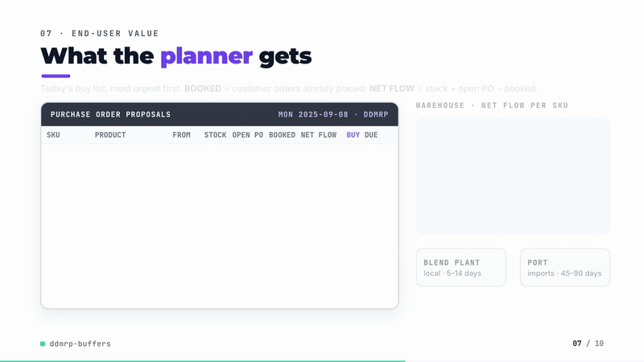
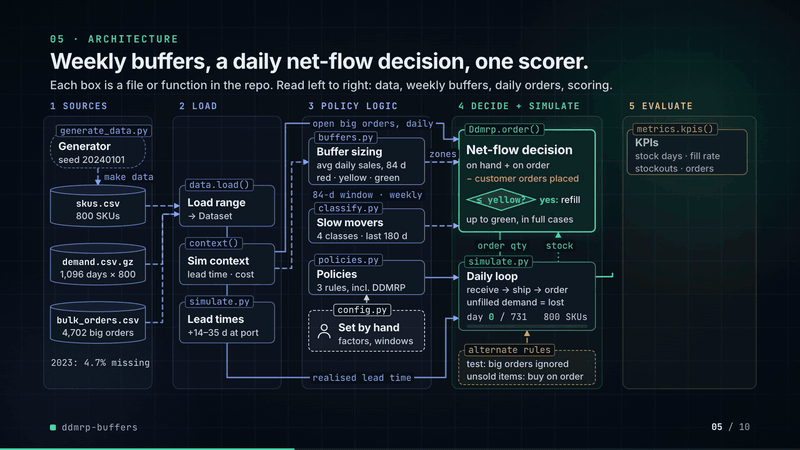
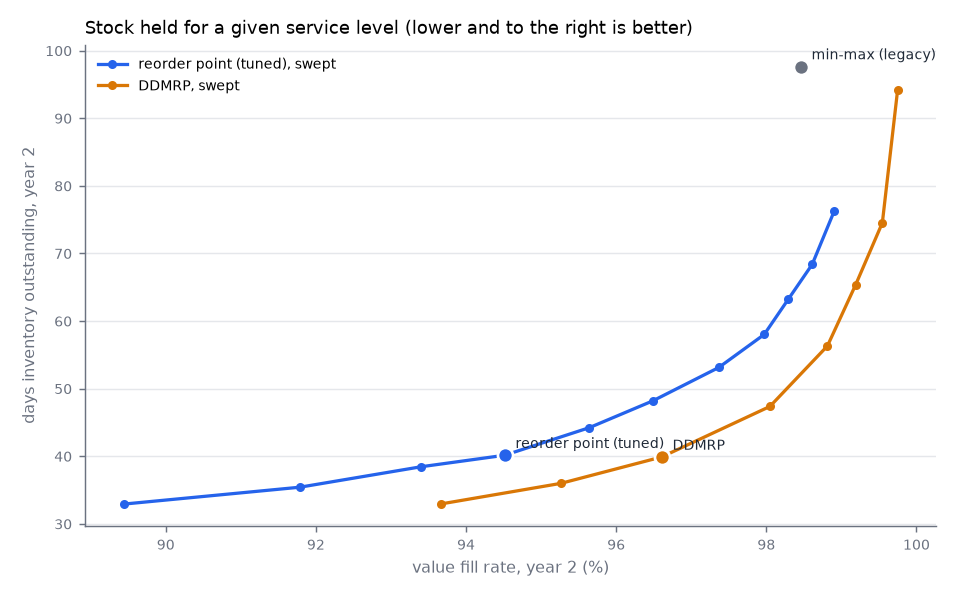
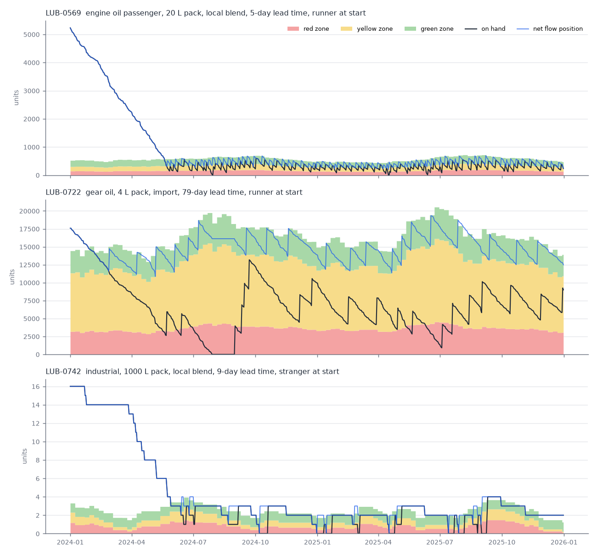
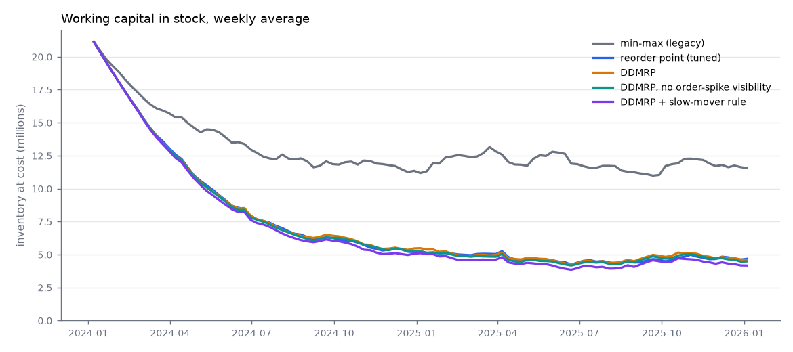

# ddmrp-buffers

[](https://github.com/kavya2693/ddmrp-buffers/actions/workflows/ci.yml)


How much stock a lubricants distributor can release by switching to demand-driven
replenishment buffers, measured at the same service level its customers get today.

[](https://kavya2693.github.io/work-demos/ddmrp-buffers.mp4)

*~86-second silent walkthrough. [Play the full video](https://kavya2693.github.io/work-demos/ddmrp-buffers.mp4) · [download the MP4, 5 MB](docs/demo/demo.mp4).*

📄 **Audit report:** every figure and assumption in the video, traced to its source — [PDF](docs/demo/AUDIT_REPORT.pdf) · [Word](docs/demo/AUDIT_REPORT.docx) · [Markdown](docs/demo/AUDIT_REPORT.md)

## At a glance

| | |
|---|---|
| **Problem** | An 800-SKU lubricants distributor buys on min-max levels reset once a year, with months of extra cover. It opens with 21.5 M of stock at cost (172 days of usage) and still stocks out when a fleet customer orders forty drums at once. |
| **Approach** | Five replenishment policies run day by day for two years against identical demand, opening stock and supplier delays: legacy min-max, a tuned weekly reorder point, full DDMRP, and two DDMRP ablations. Each safety knob is swept, and stock is read off at the fill rate the legacy policy already delivers. |
| **Result** | At the legacy policy's own **98.46%** value fill rate, DDMRP holds **52.1 days** of inventory against **97.6** for legacy min-max (**−47%**) and 65.9 for the tuned reorder point (−33%). Across this range and three freshly generated ones: 51.7 to 59.6 days against 97.6 to 108.2. |
| **What didn't win** | About 70% of the stock cut comes from recalculating weekly, not from DDMRP. Without open-order visibility DDMRP lands on the reorder point's numbers (39.8 days, 94.49% fill). The slow-mover rule frees 0.4 M but drops stranger fill rate from 92.05% to 78.72%. Purchase orders rise from about 195 to about 1,000 a month. |

## Architecture

```mermaid
flowchart LR
    subgraph SRC["Sources"]
        GEN["Seeded generator<br/>scripts/generate_data.py<br/>data.generate"]
        SKU[("skus.csv<br/>800 SKUs, lead times, MOQ, opening stock")]
        DEM[("demand.csv.gz<br/>daily demand, gaps in 2023")]
        BULK[("bulk_orders.csv<br/>fleet orders placed 3-21 days ahead")]
    end

    subgraph FEAT["Data and features"]
        LOAD["Loader<br/>data.load"]
        CTX["Simulation context<br/>simulate.context"]
        LT["Realised lead times + port holds<br/>simulate.actual_lead_times"]
        ADU["ADU + weekly CV<br/>buffers.py"]
        CLS["Runner / repeater / stranger / dormant<br/>classify.py"]
    end

    subgraph MOD["Buffer and policy models"]
        MM["Legacy min-max<br/>policies.LegacyMinMax"]
        ROP["Tuned reorder point<br/>policies.ReorderPoint"]
        ZON["Red / yellow / green zones<br/>buffers.zones"]
        DD["DDMRP (± spikes, ± slow-mover rule)<br/>policies.Ddmrp"]
    end

    subgraph DEC["Decision"]
        SPK["Qualified order spikes<br/>Context.open_spikes"]
        NFP["Net flow position<br/>buffers.net_flow"]
        ORD["Order up to top of green<br/>buffers.order_quantity"]
        SIM["Day-by-day loop<br/>simulate.simulate"]
    end

    subgraph EVAL["Evaluation"]
        KPI["DIO, fill rate, stockouts, POs<br/>metrics.kpis"]
        SWP["Safety-knob sweep<br/>cli.sweep"]
        MAT["DIO at matched service<br/>metrics.stock_at_matched_service"]
        ROB["Three fresh ranges<br/>cli.robustness_on_new_seed"]
    end

    subgraph OUT["Outputs"]
        REP[("outputs/<br/>results.md · results.json · segments.csv · frontier.csv")]
        CH["Buffer, frontier and stock charts<br/>charts.py"]
    end

    GEN --> SKU & DEM & BULK
    SKU --> LOAD
    DEM --> LOAD
    BULK --> LOAD
    LOAD -->|"Dataset"| CTX
    CTX -->|"nominal lead times"| LT
    CTX -->|"recorded demand, 84-day window"| ADU
    CTX -->|"180-day sale frequency"| CLS
    ADU -->|"ADU, CV, sigma"| ZON
    ADU --> ROP
    ADU --> MM
    ZON --> DD
    CLS -->|"class per SKU"| DD
    BULK -->|"open customer orders"| SPK
    SPK -->|"qualified demand"| NFP
    DD -->|"zones"| NFP
    NFP --> ORD
    ORD -->|"order qty per SKU"| SIM
    MM -->|"order qty per SKU"| SIM
    ROP -->|"order qty per SKU"| SIM
    LT -->|"arrival day per order"| SIM
    SIM -.->|"on hand + on order, every day"| NFP
    SIM -.->|"weekly recalculation"| ZON
    DEM -.->|"missing days skipped, not read as zero"| ADU
    SIM -->|"SimResult"| KPI
    KPI --> SWP
    SWP -->|"fill vs DIO curve"| MAT
    ROB --> REP
    KPI --> REP
    MAT --> REP
    SIM -->|"buffer trace"| CH

    classDef data fill:#7fa8ff,stroke:#3d6fd9,color:#0b1020
    classDef model fill:#b9a2ff,stroke:#7a5fd6,color:#0b1020
    classDef decision fill:#3fd8a8,stroke:#1f9c76,color:#0b1020
    classDef evaluation fill:#f2c46d,stroke:#b8902f,color:#0b1020
    classDef risk fill:#ff8a73,stroke:#cc5640,color:#0b1020

    class GEN,SKU,DEM,LOAD,CTX,ADU,CLS,REP,CH data
    class MM,ROP,ZON,DD model
    class SPK,NFP,ORD,SIM decision
    class KPI,SWP,MAT,ROB evaluation
    class LT,BULK risk
```





Solid edges are the data flow for one simulated day; dotted edges are the feedback paths (the
stock position fed back into tomorrow's net flow, the weekly buffer recalculation) and the
gap handling on the history. Red nodes are where supply and demand risk enter: late and
port-held shipments, and large customer orders.

### Components

| Component | Responsibility | File |
|---|---|---|
| Data generator and loader | 800-SKU range, three years of daily demand with season, holidays, lifecycles and ERP gaps, bulk fleet orders, opening stock; CSV round trip | [`scripts/generate_data.py`](scripts/generate_data.py), [`src/ddmrp_buffers/data.py`](src/ddmrp_buffers/data.py) |
| Constants | Calendar, lead-time bands, DDMRP factors, min-max cover, reorder-point z, slow-mover thresholds | [`src/ddmrp_buffers/config.py`](src/ddmrp_buffers/config.py) |
| Buffer arithmetic | ADU, weekly CV, lead-time and variability factors, zones, net flow, order up to top of green, case and MOQ rounding | [`src/ddmrp_buffers/buffers.py`](src/ddmrp_buffers/buffers.py) |
| Slow-mover classifier | Runner, repeater, stranger, dormant from sale frequency and recency | [`src/ddmrp_buffers/classify.py`](src/ddmrp_buffers/classify.py) |
| Policies | Legacy min-max, tuned reorder point, DDMRP with switches for open-order visibility and the slow-mover rule; open-spike qualification | [`src/ddmrp_buffers/policies.py`](src/ddmrp_buffers/policies.py) |
| Simulation | Realised lead times with port holds; daily receive, ship (lost if short), order loop; buffer traces | [`src/ddmrp_buffers/simulate.py`](src/ddmrp_buffers/simulate.py) |
| Metrics | DIO, stock at cost, value fill rate, stockout SKU-days, lost sales, POs per month; matched-service interpolation | [`src/ddmrp_buffers/metrics.py`](src/ddmrp_buffers/metrics.py) |
| Orchestrator | Every policy, both sweeps, three extra seeds, segment tables, report | [`src/ddmrp_buffers/cli.py`](src/ddmrp_buffers/cli.py) |
| Charts | Buffer zones for three SKUs, stock-versus-service frontier, stock value over time | [`src/ddmrp_buffers/charts.py`](src/ddmrp_buffers/charts.py) |

### Design decisions

| Decision | Options considered | Chosen | Trade-off |
|---|---|---|---|
| How policies are judged | DIO alone; DIO next to fill rate at default settings; stock at matched service | Sweep each policy's safety knob and read DIO at the legacy fill rate ([ADR-0001](docs/adr/0001-compare-at-matched-service.md)) | Needs eight to eleven extra runs per policy and interpolation between sweep points; a policy can fail to reach the target at all |
| Baseline | Legacy min-max only; forecast-driven MRP; statistical reorder point | Legacy min-max **and** a reorder point recalculated weekly on the same window and order cycle as DDMRP | Separates the gain from recalculating weekly from the gain from DDMRP; shrinks the headline DDMRP number |
| Unfilled demand | Backorders; lost sales | Lost sales | Fill rate measures what customers experience; policies get no credit for shipping late |
| DDMRP factors | Optimised per SKU; textbook values by band | Textbook lead-time and variability factors by band | A fair fight with fixed-rule baselines; leaves some DDMRP performance on the table |
| Variability factor input | Daily CV; weekly CV | Weekly CV, with partial weeks scaled to seven days | Daily CV is dominated by zero days on intermittent SKUs; weekly is coarser on fast movers |
| Slow-mover classification | ABC by value; sale frequency and recency | Share of days with a sale over 180 days, dormant after 120 days without one | A cheap bottle and an expensive drum with the same value are treated differently, which is the point; thresholds are judgement calls |

### Data contracts

| Stage | Input | Output |
|---|---|---|
| Generator to loader | seed, SKU count, calendar from `config.py` | `skus.csv`: `sku, family, source` (str), `pack_litres, unit_cost` (float), `lead_time_days, order_multiple, moq` (int), `lifecycle` (str), `initial_on_hand` (float); `demand.csv.gz`: `date, sku, qty` (float, empty where the 2023 extract has a gap); `bulk_orders.csv`: `sku, placed_date, due_date, qty` |
| Loader | the three CSVs | `Dataset`: `skus` frame, `dates`, `demand` array (days x SKUs, NaN for gaps), `bulk` (`sku_idx, placed_day, due_day, qty`), `initial_on_hand` |
| Policy | day index `t`, `Context` (recorded demand, lead times, MOQ, order multiple, unit cost, bulk orders), `on_hand`, `on_order` (arrays per SKU) | order quantity per SKU, already rounded to MOQ and case |
| Simulation | `Dataset`, `Policy`, lead-time seed | `SimResult`: end-of-day `on_hand`, `demand`, `filled`, `ordered`, `received` (sim days x SKUs), plus zone and net-flow traces for chosen SKUs |
| Metrics | `SimResult`, unit cost, day slice, optional SKU mask | `avg_inventory_value, dio_days, value_fill_rate, lost_sales_value, stockout_sku_day_share, skus_with_stockout_share, purchase_orders_per_month` |
| Report | per-policy KPIs, sweep curves, extra seeds | `outputs/results.md`, `results.json`, `segments.csv`, `frontier.csv`, three PNG charts |

### Failure modes and fallbacks

| Failure | What the code does |
|---|---|
| Days missing from the demand history (4.7% of 2023, including a ten-day ERP outage) | ADU averages over recorded days only, so a gap is skipped rather than read as zero sales. Weekly CV scales a partly recorded week up to seven days and drops an empty one. The classifier divides by recorded days. |
| A gap inside the simulated period | `simulate` refuses to run (`ValueError`): fill rate cannot be scored against demand that was never recorded. |
| Supplier late or shipment held at port (one import in ten, two to five extra weeks) | The order arrives on its realised day. Nothing is expedited; it stays in on-order, so net flow does not reorder the same quantity, and demand that cannot be met in the meantime is lost and counted. |
| Large customer order lands on a small buffer | If it is at least half the red zone and due within the lead time, it counts against net flow from the day it is placed, so the replenishment order goes in early. Smaller or later orders wait to hit the buffer as ordinary demand. |
| SKU with no usage in the window | Every zone is zero, so the MOQ alone cannot keep buying stock nobody asked for. |
| Invalid inputs | Zero or negative lead time and negative ADU raise `ValueError` rather than producing a buffer. |
| A policy never reaches the target fill rate in its sweep | Matched-service DIO is `None` and the report prints "not reached in the sweep" (one extra seed for the reorder point). |
| `data/` empty | The CLI generates the range from the seed before running. |
| Demand shifts with the season | Not handled. Buffers follow a trailing 84-day ADU and lag the start of a season; there are no planned adjustment factors. Listed under Known limitations. |
| Model degrades, solver or LLM timeout | Not applicable: there is no trained model, solver, LLM or network call anywhere in the pipeline. |

### Path to production

This is a mapping of each local piece to what would replace it in a deployed system, not a
description of one that exists.

| Here | Production equivalent |
|---|---|
| Seeded generator writing CSVs to `data/` | Nightly ERP extract of item master, sales order lines and open purchase orders into a warehouse (BigQuery, Snowflake or Redshift) |
| `bulk_orders.csv` | Open sales orders with requested ship date, read from the order book the same night |
| Nominal lead times in the SKU master, realised draws in `simulate` | Supplier lead times measured from goods-receipt history per supplier and lane, refreshed monthly |
| `make run` on a laptop | Scheduled jobs in Airflow or Step Functions: weekly buffer recalculation, daily net-flow and order proposal run |
| `order_quantity` output | Planned purchase orders written back to the ERP as proposals in a planner approval queue, not released automatically |
| `config.py` constants | Versioned parameter table per SKU group, with change history and an owner |
| The simulation and sweep | Shadow mode for a quarter: proposals generated next to the live min-max orders and replayed against real demand before cut-over; the sweep re-run quarterly to re-check the safety setting |
| Monitoring (not built) | Weekly value fill rate and DIO by segment (blend, import, slow-mover class); share of SKUs with net flow in red; lead time actual vs nominal by supplier; POs per month; an alert when a segment's fill rate drops below its target for two consecutive weeks |

## The problem

A regional lubricants distributor carries about 800 SKUs: the same engine oil grade in a
1 L bottle, a 4 L jug, a 20 L pail, a 208 L drum and a 1,000 L IBC, plus greases, coolants
and hydraulic oils. Most of it is blended and filled locally on a one-to-two-week cycle.
About a quarter is imported finished goods with lead times of six weeks to three months,
and one shipment in ten sits at the port for a few more weeks.

Purchasing runs on min-max levels that were set once a year from last year's average,
with a month of safety cover and three to six months of extra cover on top. The result is
the familiar one: months of stock in the warehouse, much of it on SKUs that barely sell,
and still a stockout when a fleet customer orders forty drums at once. Every day of
inventory is cash the finance team cannot use, and every lost order goes to a competitor.

## Why it is hard

Cutting stock is easy; cutting stock without losing customers is not. Any policy that
holds less will show a lower days-inventory-outstanding figure, so DIO on its own proves
nothing. And beating a legacy rule that is reset once a year is also easy: almost any
policy that is recalculated weekly will do it. The real question is whether demand-driven
buffers (DDMRP) beat a properly tuned classical policy, and what each of them costs in
fill rate and purchasing workload.

## The approach

The range is simulated day by day for two years under five replenishment policies, all
facing identical demand, identical opening stock and identical supplier delays. DDMRP is
implemented in full: average daily usage over 84 days, lead-time factors by lead-time band,
variability factors from weekly demand variation, red, yellow and green zones, the net flow
equation (on hand + on order − qualified demand, where large customer orders already placed
count against the buffer before they ship), and order generation up to top of green,
rounded to case and minimum order quantity. A slow-mover classifier splits SKUs into
runners, repeaters, strangers and dormant items by how often they sell.

The key decision ([ADR-0001](docs/adr/0001-compare-at-matched-service.md)) was to judge
policies **at matched service**. The tuned reorder point and DDMRP are each swept over their
one safety knob, and stock is read off at the fill rate the legacy policy already delivers.

## The result

Year 2 of the simulation (2025), after the opening overstock of 172 days has worked
through. Value fill rate is the share of demand value shipped on the day it was due.

| Policy | DIO (days) | Avg stock at cost | Value fill rate | Stockout SKU-days | POs per month |
|---|---:|---:|---:|---:|---:|
| Min-max (legacy, reset yearly) | 97.6 | 11.96 M | **98.46%** | 0.33% | 195 |
| Reorder point (tuned, weekly) | 40.1 | 4.72 M | 94.51% | 1.26% | 1,039 |
| DDMRP | 39.9 | 4.79 M | 96.61% | 0.62% | 1,004 |
| DDMRP without open-order visibility | 39.8 | 4.68 M | 94.49% | 0.95% | 1,002 |
| DDMRP + slow-mover rule | 37.1 | 4.39 M | 95.21% | 0.85% | 1,084 |

**The metrics disagree.** At default settings DDMRP cuts DIO from 97.6 to 39.9 days, but
fill rate falls from 98.46% to 96.61% and lost sales more than double (0.70 M to 1.54 M at cost). Reported on DIO alone, that is
a 59% improvement; it is not.

**At matched service the gain is still large, and smaller.** Read at the legacy policy's
own 98.46% fill rate:

| Policy | DIO at 98.46% fill | Change vs legacy |
|---|---:|---:|
| Min-max (legacy) | 97.6 | |
| Reorder point (tuned) | 65.9 | −33% |
| DDMRP | 52.1 | −47% |



Across this range and three freshly generated ones with fresh lead-time draws, DDMRP holds
51.7 to 59.6 days at the legacy fill rate against 97.6 to 108.2 days for legacy min-max.
The tuned reorder point needs 65.9 to 74.1 days, and on one seed never reaches the legacy
fill rate within the sweep (z up to 5.5).

Three findings that the headline hides:

1. **About 70% of the stock reduction comes from recalculating weekly, not from DDMRP.**
   A tuned reorder point already gets DIO from 97.6 to 65.9 days at the same fill rate;
   DDMRP adds the remaining 13.8 days.
2. **DDMRP's edge over the reorder point is the net flow equation.** With open-order
   visibility switched off, DDMRP lands on the reorder point's numbers (39.8 days,
   94.49% fill). In this range 13.6% of demand value arrives as bulk fleet orders placed
   3 to 21 days ahead; a distributor with less advance visibility would see less benefit.
3. **The slow-mover rule buys cash with service on strangers.** Holding only a red zone
   on SKUs that sell on fewer than one day in ten frees a further 0.4 M, but their fill rate
   drops from 92.05% to 78.72%. That is a commercial decision, not a free win.

The cost on the other side is purchasing workload: weekly-recalculated policies raise
purchase orders from about 195 to about 1,000 a month, mostly small local blend orders.

`outputs/results.md` has year 1, both years, every segment (local blend vs import, and each
slow-mover class) and the full sweep.

## How it works

```
data/ (skus, daily demand, bulk orders, opening stock)
  │
  ▼
simulate.py ── for each day ──► receive arrivals ─► ship demand (unfilled is lost)
  │                              ─► policy.order(stock, on order, open customer orders)
  │                              ─► place order with this day's realised lead time
  ▼
policies.py   legacy min-max · tuned reorder point · DDMRP (± spikes, ± slow-mover rule)
buffers.py    ADU, LTF, VF, zones, net flow, order up to top of green
classify.py   runner / repeater / stranger / dormant from sale frequency and recency
metrics.py    DIO, stock at cost, value fill rate, stockout SKU-days, POs, matched-service DIO
cli.py        runs every policy, the safety sweeps and three extra seeds; writes outputs/
```

Buffers are recalculated every seven days. A customer order counts against the buffer
early when it is at least half the red zone and due within the decoupled lead time.
Strangers under the slow-mover rule keep only the red zone and are bought in the quantity
needed; dormant SKUs hold nothing and are bought only against an order in hand.



The top panel is a local-blend runner: on-hand cycles through the green and yellow zones
once the opening overstock is gone. The middle panel is an imported runner with a 79-day
lead time; the 34 days at zero in August 2024 follow two orders that took 118 and 100
days to arrive against a nominal 79. The bottom is a stranger that sells one IBC every few weeks.



## Running it

```bash
uv sync
make data     # writes data/skus.csv, data/demand.csv.gz, data/bulk_orders.csv (seed 20240101)
make run      # all policies, sweeps and extra seeds; tables and charts to outputs/ (~20 s)
make check    # ruff, format, mypy, pytest
docker build -t ddmrp-buffers . && docker run --rm ddmrp-buffers
```

Policy constants (zone factors, windows, order cycles, slow-mover thresholds) are in
`src/ddmrp_buffers/config.py`. No API key, model or network access is needed.

## The data

The dataset is generated by the seeded script `scripts/generate_data.py` and sized to the
production problem (800 SKUs, three years of daily demand); production data is
proprietary. It carries an annual season by product family, a quiet weekday, public
holidays, a fasting month and post-holiday restocking, heavy-tailed volumes, growing,
declining, phased-out and newly launched SKUs, 4,702 bulk fleet orders announced 3 to 21
days ahead, and 4.7% missing days in the first year's ERP extract, including a ten-day
outage. Opening stock reflects a range run on generous cover: 21.5 M at cost, 172 days of
trailing usage. 2023 is history only; 2024 and 2025 are simulated.

## Tests

`make check` runs 19 tests. The two that matter most:

- `test_zones_match_hand_worked_example` checks the zone arithmetic, net flow and case
  rounding against a buffer worked out by hand (ADU 10, DLT 10, LTF 0.7, VF 0.5 gives
  TOR 105, TOY 205, TOG 275, and a net flow of 140 orders 144 units). It was written
  before the simulation existed.
- `test_stock_balance_holds_every_day` checks for each policy that closing stock equals
  opening stock plus receipts minus shipments on every day and SKU, that nothing arrives
  that was not ordered, and that stock never goes negative.

Others cover open-order qualification (placed, due, horizon, threshold), the classifier,
the KPI arithmetic, matched-service interpolation, generator determinism and a steady
demand SKU that must never stock out under DDMRP.

## Known limitations

- **The biggest gap: the data is generated, so the size of DDMRP's edge depends on
  choices I made.** In particular, its advantage over the reorder point comes from bulk
  orders being visible in advance. The share and the notice period are assumptions, not
  measurements; with real order books the gap could be larger or close to zero.
- Single stocking point. No blending capacity, shared base oils or filling-line schedule,
  so a local blend is assumed to be available on its lead time whatever else is running.
- No planned adjustment factors for seasonality; buffers follow a trailing 84-day ADU and
  lag the start of a season. Coolant, the most seasonal family, drops to 93-96% fill in
  several spring and summer months against about 99% in winter.
- The slow-mover rule assumes strangers can be bought below the usual MOQ. If the blend
  plant or supplier will not accept that, the rule frees less cash.
- Purchase order counts are reported but not costed; there is no ordering or freight cost
  in the objective.
- Disposal of dead stock is not modelled. Opening stock on dormant SKUs stays on the
  books under every policy; releasing it takes a write-off or a sale, not a buffer.
- The Docker image is built and run in CI; it could not be built on the development machine.

## Insights and learning

I picked this because a DIO number on a resume invites the obvious question: how much
service did you give up for it? Building the comparison properly answered that, and the
answer was not the one I expected going in. I assumed DDMRP's benefit would come from the
zone sizing. The ablation says otherwise: with the same window, the same recalculation
cadence and the same order cycle, a textbook reorder point is as good at sizing stock, and
DDMRP pulls ahead because its net flow equation counts orders customers have already
placed. That is a practice any planning team could adopt without the rest of the method.

The second surprise was how much of the cash comes from discipline rather than method.
Recalculating weekly instead of yearly does most of the work. The DDMRP-specific gain is
real but it is the smaller part, and the purchasing team pays for both in order volume.

What I got wrong first: the initial version compared DDMRP only with legacy min-max and
reported DIO, which made it look like a 59% reduction for free. Adding fill rate and the
tuned baseline is what made the result defensible. Next I would add seasonal adjustment
factors to the buffers, cost purchase orders and freight so the comparison has one
objective, and test the open-order effect on a real order book.

## License

MIT
