# ddmrp-buffers: demo video audit report

**Repository:** https://github.com/kavya2693/ddmrp-buffers  
**Numbers taken from commit:** `ef2e497` (outputs last changed in `ef2e497 (2026-10-13 17:53:42 +0400)`)  
**Video:** `docs/demo/demo.mp4` (89.2 s, 1920x1080, 30 fps, silent)  
**Generated:** 2026-10-14 18:39  
**Automated checks:** 54 pass · 0 fail · 2 manual (of 56 figures)

## How to use this report

Every number or claim on screen has an ID (`F-01`, `F-02`, ...) and every modelling assumption has an ID (`A-01`, ...). Cite the ID. Each figure lists its source file, the exact column/row/key, the formula for derived numbers, and an automated check result. The change-impact matrix tells you which slides and files change if an input or assumption changes.

Types: **direct** = read straight from a repo output; **derived** = computed from direct values (formula given); **illustrative** = drawing or example, not data; **general knowledge** = context not produced by the repo.

### Regenerate

```bash
make run                                   # data/*.csv, outputs/results.json, frontier.csv, segments.csv, 3 PNGs (~20 s)
python3 docs/demo/source/tools/darkmap.py outputs docs/demo/source/assets
PYTHONPATH=src .venv/bin/python docs/demo/source/tools/export_po_sheet.py docs/demo/source/assets/po_sheet.json 2025-09-08
python3 docs/demo/source/tools/inject_sheet.py docs/demo/source/assets/po_sheet.json docs/demo/source/compositions/value.html --rows LUB-0022,LUB-0304,LUB-0540,LUB-0079,LUB-0788,LUB-0035 --animate LUB-0022,LUB-0304,LUB-0079,LUB-0035
cd docs/demo/source && npx --yes hyperframes@0.8.156 check && npx --yes hyperframes@0.8.156 render -f 30 -q looks -o renders/ddmrp-buffers-master.mp4 && cd -
ffmpeg -y -i docs/demo/source/renders/ddmrp-buffers-master.mp4 -c:v libx264 -preset slow -crf 25 -pix_fmt yuv420p -movflags +faststart -an docs/demo/demo.mp4
python3 docs/demo/source/tools/build_audit_report.py docs/demo/source/audit/facts.yaml   # stills, checks, MD/DOCX/PDF
```

## 1. Figures

| ID | Shown on screen | Slides | Source | Column / row / key | How computed | Type | Check |
|---|---|---|---|---|---|---|---|
| F-01 | 3 industry chips | 01 | `author's framing` | - | - | general knowledge | manual: Context statement, not a repo output. |
| F-02 | 4 problem cards | 01 | `README 'The problem'` | README lines 13-27 | - | general knowledge | ✓ verified |
| F-03 | 800 SKUs | 02, 03, 05, 08, 10 | `outputs/results.json` | dataset.skus | - | direct | ✓ verified |
| F-04 | 21.5M in stock | 02 | `outputs/results.json` | opening_stock_value = 21,516,738 | / 1e6, 1 decimal | direct | ✓ verified |
| F-05 | 172 days of cover | 02 | `outputs/results.json` | opening_dio_days = 172.03 | - | direct | ✓ verified |
| F-06 | 26% imports | 02 | `outputs/results.json` | dataset.import_share = 0.26375 | x 100 | direct | ✓ verified |
| F-07 | 45–90 d to arrive | 02 | `data/skus.csv` | lead_time_days where source = import (min, max) | - | direct | ✓ verified |
| F-08 | 4,702 big orders | 02, 05 | `outputs/results.json; data/bulk_orders.csv` | dataset.bulk_orders | - | direct | ✓ verified |
| F-09 | booked 3–21 d ahead / 3 to 21 days before they ship | 02, 04 | `data/bulk_orders.csv` | due_date - placed_date (min, max) | - | direct | ✓ verified |
| F-10 | 60% of SKU-days sell nothing | 02 | `outputs/results.json` | dataset.zero_demand_day_share = 0.5968 | x 100, whole number | direct | ✓ verified |
| F-11 | average daily sales, last 84 days / avg daily sales, 84 d / 84-d window | 03, 05 | `src/ddmrp_buffers/config.py:24` | adu_window_days = 84 | - | direct | ✓ verified |
| F-12 | EVERY 7 DAYS / weekly | 03, 05 | `src/ddmrp_buffers/config.py:25; policies.py:154` | recalc_every_days = 7 | - | direct | ✓ verified |
| F-13 | EVERY DAY / all 800 SKUs, daily / per-day call | 03, 05 | `src/ddmrp_buffers/simulate.py:77-88` | for t in range(n_days): ... policy.order(...) | - | direct | ✓ verified |
| F-14 | 47% less stock / same fill rate / full cases | 03 | `outputs/results.json; src/ddmrp_buffers/buffers.py:104-106` | matched_service DDMRP vs legacy year-2 DIO; round_up | (1 - 52.14 / 97.64) x 100 = 46.6% -> 47%; DIO read at the legacy fill rate (A-08) | derived | ✓ verified |
| F-15 | on hand + on order − orders already placed | 04 | `src/ddmrp_buffers/buffers.py:99-101; policies.py:160-165` | net_flow() | - | direct | ✓ verified |
| F-16 | red 105 / yellow 205 / green 275 / net flow 170 -> 140 / Order 144 | 04 | `tests/test_buffers.py:12-27 (test_zones_match_hand_worked_example)` | assertions in the test | 275 - 140 = 135 -> 144 (cases of 12) | direct | ✓ verified |
| F-17 | Without the customer order: 108. | 04 | `tests/test_buffers.py:12-27 inputs; buffers.order_quantity / round_up` | net flow 170 (120 + 50), TOG 275, MOQ 50, case 12 | 275 - 170 = 105 -> ceil(105 / 12) x 12 = 108 | derived | ✓ verified |
| F-18 | 94.49% vs 94.51% | 04, 09 | `outputs/results.json` | policies['DDMRP, no order-spike visibility'] / ['reorder point (tuned)'].year_2.value_fill_rate | x 100, 2 decimals | direct | ✓ verified |
| F-19 | seed 20240101 | 05 | `src/ddmrp_buffers/config.py:8` | SEED | - | direct | ✓ verified |
| F-20 | 1,096 days × 800 / 2023: 4.7% missing | 05 | `outputs/results.json` | dataset.days_total, dataset.history_missing_share | - | direct | ✓ verified |
| F-21 | +14–35 d at port | 05 | `src/ddmrp_buffers/simulate.py:49-50` | 10% of import orders held rng.integers(14, 36) days | - | direct | ✓ verified |
| F-22 | avg daily sales, 84 d / red · yellow · green / ≤ yellow? yes: refill up to green, in full cases | 05 | `src/ddmrp_buffers/buffers.py:35-119` | average_daily_usage, lead_time_factor, variability_factor, zones, net_flow, order_quantity | - | direct | ✓ verified |
| F-23 | 4 classes · last 180 d | 05 | `src/ddmrp_buffers/classify.py:13-14; config.py:66` | RUNNER, REPEATER, STRANGER, DORMANT; window_days = 180 | - | direct | ✓ verified |
| F-24 | day 731 / 731 · 731 simulated days | 05, 08 | `outputs/results.json` | dataset.days_simulated | - | direct | ✓ verified |
| F-25 | 11 + 8 safety settings / Reorder point run at 11 safety settings, DDMRP at 8 | 05, 06 | `src/ddmrp_buffers/cli.py:14-15` | len(ROP_Z_SWEEP), len(DDMRP_RED_SWEEP) | - | direct | ✓ verified |
| F-26 | + 3 new datasets / 4 datasets | 05, 08 | `outputs/results.json robustness; cli.py:252` | len(robustness) = 4 (main + 3) | - | direct | ✓ verified |
| F-27 | ×90 / 90 runs | 05 | `src/ddmrp_buffers/cli.py:18-25, 76-93, 120-131, 175-177` | 5 arms + 19 sweep runs on the main range; 3 policies + 19 sweep runs on each of 3 extra ranges | 5 + 19 + 3 x (3 + 19) = 90 | derived | ✓ verified |
| F-28 | ≈ 20 s / ~20 s | 05, 10 | `README 'Running it'` | '(~20 s)' | - | direct | ✓ verified |
| F-29 | 98.46% | 05, 06, 08, 09 | `outputs/results.json` | matched_service.target_value_fill_rate_year_2 | x 100 | direct | ✓ verified |
| F-30 | generate_data.py, data.load(), context(), simulate.py, buffers.py, classify.py, policies.py, config.py, Ddmrp.order(), metrics.kpis(), metrics.py, cli.py, charts.py, outputs/ | 05 | `src/ddmrp_buffers/, scripts/` | files + functions | - | direct | ✓ verified |
| F-31 | LOCAL BLEND · 5-DAY LEAD / IMPORT · 79-DAY LEAD | 06 | `outputs/buffer_chart.png (panel titles); data/skus.csv` | sku, source, lead_time_days | - | direct | ✓ verified |
| F-32 | legacy fill 98.46% + three rings | 06 | `outputs/frontier.png (axes); compositions/s04-routes.html (X/Y mapping)` | tick positions in the dark image | x = 332 + (fill - 90) x 150.1, y = 968 - (DIO - 30) x 13.514 (image pixels) | illustrative | manual: Annotation placed by the chart's own axis ticks; the curves are the repo's PNG, not redrawn. Visually confirmed: the rings sit on the legacy dot and on both swept curves. |
| F-33 | 97.6 / 65.9 / 52.1 | 06 | `outputs/results.json` | policies['min-max (legacy)'].year_2.dio_days; matched_service.dio_at_target | - | direct | ✓ verified |
| F-34 | −47% | 06, 08 | `outputs/results.json` | F-33 | (52.14 / 97.64 - 1) x 100 = -46.6% | derived | ✓ verified |
| F-35 | MON 2025-09-08 · DDMRP | 07 | `demo assets/po_sheet.json (re-run of the repo's default DDMRP simulation)` | day, weekday | - | direct | ✓ verified |
| F-36 | 49 purchase orders | 07 | `demo assets/po_sheet.json` | orders = number of SKUs with order qty > 0 | - | direct | ✓ verified |
| F-37 | 127,376 at cost | 07 | `demo assets/po_sheet.json` | order_value = sum(order qty x unit cost) | - | direct | ✓ verified |
| F-38 | 7 pulled in by customer orders | 07 | `demo assets/po_sheet.json` | with_customer_orders = 7; triggered_by_customer_orders = 7 (net flow without them would sit above top of yellow) | - | direct | ✓ verified |
| F-39 | + 43 more SKUs to order today | 07 | `F-36` | 49 - 6 rows | 49 - 6 = 43 | derived | ✓ verified |
| F-40 | LUB-0022, LUB-0304, LUB-0540, LUB-0079, LUB-0788, LUB-0035 | 07 | `demo assets/po_sheet.json, injected into compositions/value.html` | rows by SKU | due = order day + nominal lead time; rows ordered most urgent first (net flow / top of green); LUB-0540 kept as a high-volume line | direct | ✓ verified |
| F-41 | local · 5–14 days / imports · 45–90 days | 07 | `data/skus.csv` | lead_time_days by source (min, max) | - | direct | ✓ verified |
| F-42 | +3 / +6 / +76 / +42 with green checks | 07 | `demo assets/po_sheet.json` | net_flow + order_qty >= tog | - | direct | ✓ verified |
| F-43 | −13.7 d (65.9 → 52.1 days) | 08 | `outputs/results.json` | matched_service.dio_at_target | 65.888 - 52.140 = 13.75 -> 13.7 | derived | ✓ verified |
| F-44 | 59.6 d | 08 | `outputs/results.json` | max(robustness[].ddmrp_dio_at_legacy_fill) | max over 4 ranges | direct | ✓ verified |
| F-45 | legacy: 97.6–108.2 days | 08 | `outputs/results.json` | robustness[].legacy_dio (min, max) | - | direct | ✓ verified |
| F-46 | 5.1× | 08 | `outputs/results.json` | policies[*].year_2.purchase_orders_per_month: 1,004.1 / 195.1 | 1,004.1 / 195.1 = 5.15 | derived | ✓ verified |
| F-47 | 195 → 1,004 a month | 08 | `outputs/results.json` | policies[*].year_2.purchase_orders_per_month | - | direct | ✓ verified |
| F-48 | 5 policies | 08, 10 | `outputs/results.json` | len(policies) | - | direct | ✓ verified |
| F-49 | 2.49 M / 2.50 M / 1.54 M | 09 | `outputs/results.json` | policies['reorder point (tuned)' \| 'DDMRP, no order-spike visibility' \| 'DDMRP'].year_2.lost_sales_value | / 1e6, 2 decimals | direct | ✓ verified |
| F-50 | about 40 days of stock / ~40 days of stock | 09 | `outputs/results.json` | policies[*].year_2.dio_days | each within 40 ± 0.5 days | derived | ✓ verified |
| F-51 | −38% | 09 | `outputs/results.json` | F-49 | 1.5405 / 2.5026 - 1 = -38.4%; 1.5405 / 2.4906 - 1 = -38.1% | derived | ✓ verified |
| F-52 | policies.py: an order of at least half the red zone, due within the lead time, cuts net flow at once. On by default. | 09 | `src/ddmrp_buffers/policies.py:39-47, 119, 160-165; config.py:39; tests/test_simulation.py:79-97` | Context.open_spikes, Ddmrp.use_spikes, spike_threshold_share = 0.5 | - | direct | ✓ verified |
| F-53 | 52.1 vs 65.9 days | 09 | `outputs/results.json` | matched_service.dio_at_target | - | direct | ✓ verified |
| F-54 | MIT | 10 | `LICENSE line 1` | - | - | direct | ✓ verified |
| F-55 | Python 3.11 · NumPy · pandas · matplotlib | 10 | `pyproject.toml` | requires-python, dependencies | - | direct | ✓ verified |
| F-56 | $ make run | 10 | `Makefile` | run target | - | direct | ✓ verified |

## 2. Automated check run (2026-10-14 18:39)

| ID | Expected on slide | Recomputed from repo | Result |
|---|---|---|---|
| F-01 | 3 industry chips | - | manual |
| F-02 | true | true | ✓ pass |
| F-03 | 800 | 800 | ✓ pass |
| F-04 | 21.5M | 21.5M | ✓ pass |
| F-05 | 172 | 172 | ✓ pass |
| F-06 | 26% | 26% | ✓ pass |
| F-07 | 45–90 | 45–90 | ✓ pass |
| F-08 | 4,702 | 4,702 | ✓ pass |
| F-09 | 3–21 | 3–21 | ✓ pass |
| F-10 | 60% | 60% | ✓ pass |
| F-11 | true | true | ✓ pass |
| F-12 | true | true | ✓ pass |
| F-13 | true | true | ✓ pass |
| F-14 | true | true | ✓ pass |
| F-15 | true | true | ✓ pass |
| F-16 | true | true | ✓ pass |
| F-17 | 108 | 108 | ✓ pass |
| F-18 | 94.49% vs 94.51% | 94.49% vs 94.51% | ✓ pass |
| F-19 | true | true | ✓ pass |
| F-20 | 1,096 d, 4.7% | 1,096 d, 4.7% | ✓ pass |
| F-21 | true | true | ✓ pass |
| F-22 | true | true | ✓ pass |
| F-23 | true | true | ✓ pass |
| F-24 | 731 | 731 | ✓ pass |
| F-25 | 11 z, 8 red | 11 z, 8 red | ✓ pass |
| F-26 | true | true | ✓ pass |
| F-27 | 90 | 90 | ✓ pass |
| F-28 | true | true | ✓ pass |
| F-29 | 98.46% | 98.46% | ✓ pass |
| F-30 | true | true | ✓ pass |
| F-31 | true | true | ✓ pass |
| F-32 | legacy fill 98.46% + three rings | - | manual |
| F-33 | 97.6 / 65.9 / 52.1 | 97.6 / 65.9 / 52.1 | ✓ pass |
| F-34 | -47% | -47% | ✓ pass |
| F-35 | true | true | ✓ pass |
| F-36 | 49 | 49 | ✓ pass |
| F-37 | 127,376 | 127,376 | ✓ pass |
| F-38 | true | true | ✓ pass |
| F-39 | 43 | 43 | ✓ pass |
| F-40 | true | true | ✓ pass |
| F-41 | 5–14 / 45–90 | 5–14 / 45–90 | ✓ pass |
| F-42 | true | true | ✓ pass |
| F-43 | -13.7 | -13.7 | ✓ pass |
| F-44 | 59.6 | 59.6 | ✓ pass |
| F-45 | 97.6–108.2 | 97.6–108.2 | ✓ pass |
| F-46 | 5.1 | 5.1 | ✓ pass |
| F-47 | 195 → 1,004 | 195 → 1,004 | ✓ pass |
| F-48 | 5 | 5 | ✓ pass |
| F-49 | 2.49 M / 2.50 M / 1.54 M | 2.49 M / 2.50 M / 1.54 M | ✓ pass |
| F-50 | true | true | ✓ pass |
| F-51 | -38% | -38% | ✓ pass |
| F-52 | true | true | ✓ pass |
| F-53 | 52.1 vs 65.9 | 52.1 vs 65.9 | ✓ pass |
| F-54 | true | true | ✓ pass |
| F-55 | true | true | ✓ pass |
| F-56 | true | true | ✓ pass |

## 3. Assumptions register

| ID | Assumption | Source | Used by | Sensitivity: if this changes |
|---|---|---|---|---|
| A-01 | All data is synthetic, produced by a seeded generator sized to the production problem (800 SKUs, three years of daily demand, 4,702 bulk orders). The production data is proprietary. | `scripts/generate_data.py; src/ddmrp_buffers/data.py:95-188 (generate); config.py:8 (SEED = 20240101); README 'The data'` | all figures | figures all figures and slides 01, 02, 03, 04, 05, 06, 07, 08, 09, 10 change |
| A-02 | Bulk fleet orders are announced 3 to 21 days before they ship: 60% of SKUs packed in 18 L or more get 2-8 such orders a year (15% of the rest get 2). Their share (13.6% of demand value) and notice period are generator choices, not measurements; DDMRP's edge over the reorder point depends on them. | `src/ddmrp_buffers/data.py:154-171; README 'Known limitations' (the biggest gap)` | F-08, F-09, F-16, F-17, F-18, F-36, F-37, F-38, F-49, F-51 | figures F-08, F-09, F-16, F-17, F-18, F-36, F-37, F-38, F-49, F-51 and slides 02, 04, 05, 07, 09 change |
| A-03 | Unfilled demand is lost, not backordered (a workshop buys the drum elsewhere). Fill rate is the share of demand value shipped on the day it was due. | `src/ddmrp_buffers/simulate.py:81-83; metrics.py:27; docs/adr/0001-compare-at-matched-service.md` | F-18, F-29, F-33, F-34, F-43, F-44, F-49, F-51, F-53 | figures F-18, F-29, F-33, F-34, F-43, F-44, F-49, F-51, F-53 and slides 04, 05, 06, 08, 09 change |
| A-04 | Lead times: local blends 5-14 days, imports 45-90 days. Realised lead times drift (sd 15% blends, 10% imports) and 10% of import orders are held at the port for 14-35 extra days. | `src/ddmrp_buffers/data.py:109-114; simulate.py:42-51 (actual_lead_times)` | F-07, F-21, F-33, F-34, F-41, F-44, F-49, F-50, F-51, F-53 | figures F-07, F-21, F-33, F-34, F-41, F-44, F-49, F-50, F-51, F-53 and slides 02, 05, 06, 07, 08, 09 change |
| A-05 | DDMRP settings: 84-day ADU window, buffers recalculated every 7 days, lead-time factor 0.7 / 0.5 / 0.3 by lead-time band, variability factor 0.3 / 0.5 / 0.8 by weekly CV, a customer order counts early if it is at least half the red zone and due within the lead time, order cycle 7 days (blend) / 30 days (import). | `src/ddmrp_buffers/config.py:22-41 (DdmrpSettings)` | F-11, F-12, F-22, F-33, F-34, F-36, F-37, F-38, F-40, F-42, F-43, F-44, F-49, F-50, F-51, F-52, F-53 | figures F-11, F-12, F-22, F-33, F-34, F-36, F-37, F-38, F-40, F-42, F-43, F-44, F-49, F-50, F-51, F-52, F-53 and slides 03, 05, 06, 07, 08, 09 change |
| A-06 | Legacy min-max: min = usage over lead time + 30 days, max = min + 90 days (blend) or 180 days (import), reset once a year from last year's average daily usage. | `src/ddmrp_buffers/config.py:44-50; policies.py:60-79` | F-29, F-33, F-34, F-45, F-47, F-53 | figures F-29, F-33, F-34, F-45, F-47, F-53 and slides 05, 06, 08, 09 change |
| A-07 | Tuned reorder point: z = 1.88 (97% cycle service), same 84-day window, weekly recalculation and order cycle as DDMRP. The safety knobs are swept over 11 z values (0.84-5.5) and 8 DDMRP red-zone multipliers (0.5-4.0). | `src/ddmrp_buffers/config.py:53-61; cli.py:14-15 (ROP_Z_SWEEP, DDMRP_RED_SWEEP)` | F-25, F-27, F-33, F-34, F-43, F-44, F-49, F-50, F-53 | figures F-25, F-27, F-33, F-34, F-43, F-44, F-49, F-50, F-53 and slides 05, 06, 08, 09 change |
| A-08 | Stock at matched service = DIO linearly interpolated along each policy's swept (fill rate, DIO) curve at the legacy policy's year-2 fill rate (98.46%). | `src/ddmrp_buffers/metrics.py:42-49; cli.py:172-174; docs/adr/0001-compare-at-matched-service.md` | F-14, F-29, F-33, F-34, F-43, F-44, F-53 | figures F-14, F-29, F-33, F-34, F-43, F-44, F-53 and slides 03, 05, 06, 08, 09 change |
| A-09 | Headline window is year 2 of the simulation (2025), after the opening overstock has worked through; 2023 is history only, 2024-2025 are simulated (731 days). | `src/ddmrp_buffers/cli.py:141-143; config.py:10-12` | F-24, F-29, F-33, F-34, F-43, F-44, F-45, F-46, F-47, F-49, F-50, F-51, F-53 | figures F-24, F-29, F-33, F-34, F-43, F-44, F-45, F-46, F-47, F-49, F-50, F-51, F-53 and slides 05, 06, 08, 09 change |
| A-10 | Opening stock reflects generous cover (lognormal around 110 days, x1.6 on imports and on declining or phased-out SKUs): 21.5 M at cost, 172 days of trailing usage. | `src/ddmrp_buffers/data.py:179-186; metrics.py:35-39` | F-04, F-05 | figures F-04, F-05 and slides 02 change |
| A-11 | Lead-time draws use simulation seed 7 for the main range; the three extra ranges use their own seed for both the range and the draws. Slide 07 shows one day (Monday 2025-09-08) of the same DDMRP run, chosen by the video author as a weekday with both imports and customer-order pulls. | `src/ddmrp_buffers/simulate.py:55 (seed=7); cli.py:120-131; demo tools/export_po_sheet.py` | F-35, F-36, F-37, F-38, F-39, F-40, F-42, F-44, F-45 | figures F-35, F-36, F-37, F-38, F-39, F-40, F-42, F-44, F-45 and slides 07, 08 change |
| A-12 | Purchase orders are counted, not costed: there is no ordering or freight cost in the comparison. | `src/ddmrp_buffers/metrics.py:31; README 'Known limitations'` | F-46, F-47 | figures F-46, F-47 and slides 08 change |
| A-13 | Video rounding: days to 1 decimal, fill rates to 2 decimals, headline percentages to whole numbers, money to 0.01 M, 0.1 M or whole units; '~20 s', 'about 40 days' and '60%' are rounded labels. | `this audit (display convention)` | F-04, F-05, F-06, F-10, F-14, F-20, F-34, F-43, F-46, F-49, F-50, F-51 | figures F-04, F-05, F-06, F-10, F-14, F-20, F-34, F-43, F-46, F-49, F-50, F-51 and slides 02, 03, 05, 06, 08, 09 change |
| A-14 | Slide 01 (industries, everyday problems) is general distribution knowledge used as context. It is not a result of this repo and carries no numbers. | `author's framing; README 'The problem' supports all four problems` | F-01, F-02 | figures F-01, F-02 and slides 01 change |

## 4. Slide by slide

### Slide 01: The industry  
*0.0-7.2 s · composition `compositions/s01-context.html`*

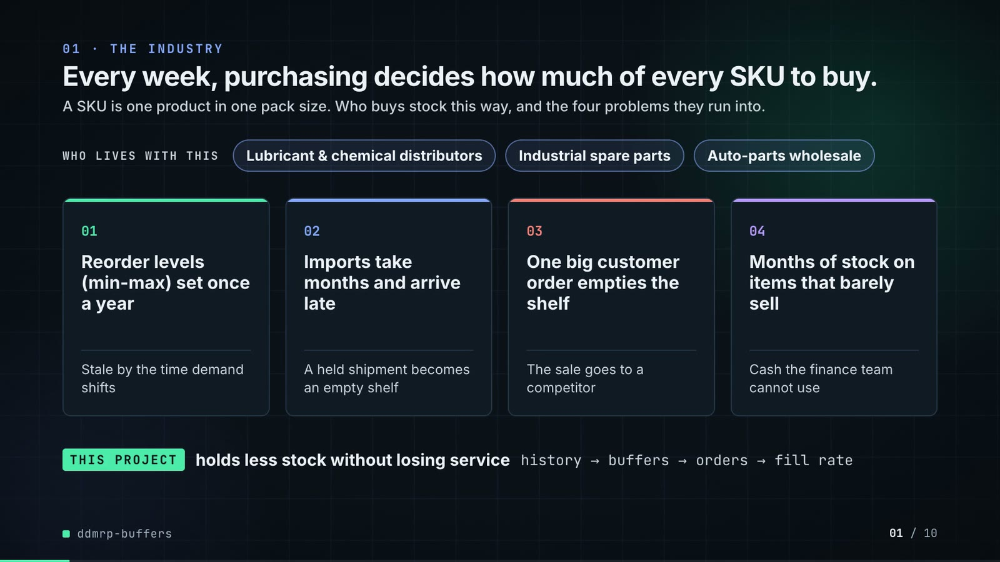

**On-screen text (verbatim)**

> 01 · THE INDUSTRY  
> Every week, purchasing decides how much of every SKU to buy.  
> A SKU is one product in one pack size. Who buys stock this way, and the four problems they run into.  
> WHO LIVES WITH THIS · Lubricant & chemical distributors · Industrial spare parts · Auto-parts wholesale  
> 01 Reorder levels (min-max) set once a year — Stale by the time demand shifts  
> 02 Imports take months and arrive late — A held shipment becomes an empty shelf  
> 03 One big customer order empties the shelf — The sale goes to a competitor  
> 04 Months of stock on items that barely sell — Cash the finance team cannot use  
> THIS PROJECT holds less stock without losing service · history → buffers → orders → fill rate  

**Figures on this slide**

| ID | Shown | Source · key | Calculation | Check |
|---|---|---|---|---|
| F-01 | 3 industry chips | `author's framing` · - | - | manual |
| F-02 | 4 problem cards | `README 'The problem'` · README lines 13-27 | - | ✓ |

**Assumptions:** A-14

**Illustrative, not data:**

- The whole slide is context; no repo figures.

**To change this slide:** Edit the subtitle (#ctx-sub), chips (#ctx-c1..3) and cards (#ctx-k1..4) in compositions/s01-context.html. (project folder `docs/demo/source`).

### Slide 02: This project  
*6.8-12.0 s · composition `compositions/s02-hook.html`*

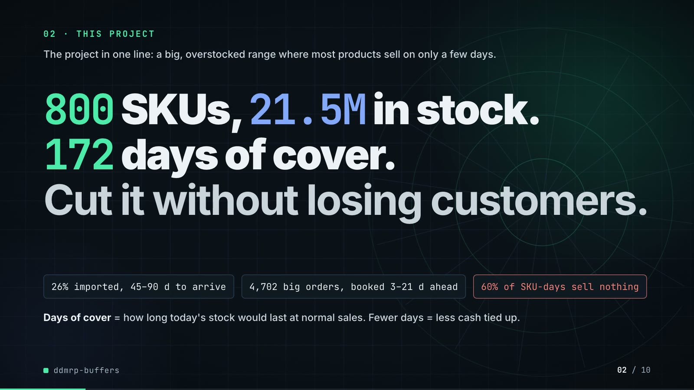

**On-screen text (verbatim)**

> 02 · THIS PROJECT  
> The project in one line: a big, overstocked range where most products sell on only a few days.  
> 800 SKUs, 21.5M in stock. 172 days of cover. Cut it without losing customers.  
> 26% imported, 45–90 d to arrive · 4,702 big orders, booked 3–21 d ahead · 60% of SKU-days sell nothing  
> Days of cover = how long today's stock would last at normal sales. Fewer days = less cash tied up.  

**Figures on this slide**

| ID | Shown | Source · key | Calculation | Check |
|---|---|---|---|---|
| F-03 | 800 SKUs | `outputs/results.json` · dataset.skus | - | ✓ |
| F-04 | 21.5M in stock | `outputs/results.json` · opening_stock_value = 21,516,738 | / 1e6, 1 decimal | ✓ |
| F-05 | 172 days of cover | `outputs/results.json` · opening_dio_days = 172.03 | - | ✓ |
| F-06 | 26% imports | `outputs/results.json` · dataset.import_share = 0.26375 | x 100 | ✓ |
| F-07 | 45–90 d to arrive | `data/skus.csv` · lead_time_days where source = import (min, max) | - | ✓ |
| F-08 | 4,702 big orders | `outputs/results.json; data/bulk_orders.csv` · dataset.bulk_orders | - | ✓ |
| F-09 | booked 3–21 d ahead / 3 to 21 days before they ship | `data/bulk_orders.csv` · due_date - placed_date (min, max) | - | ✓ |
| F-10 | 60% of SKU-days sell nothing | `outputs/results.json` · dataset.zero_demand_day_share = 0.5968 | x 100, whole number | ✓ |

**Assumptions:** A-01, A-02, A-04, A-10

**Illustrative, not data:**

- Rings in the background are decoration.

**To change this slide:** Headline spans #hook-l1..l3, chips #hook-f1..f3 and the definition line #hook-def in compositions/s02-hook.html; numbers from outputs/results.json (dataset, opening_*). (project folder `docs/demo/source`).

### Slide 03: How it works (white chapter, slide A)  
*11.7-19.7 s · composition `compositions/explainer.html (CONFIG.blocks, CONFIG.groups, CONFIG.loop)`*

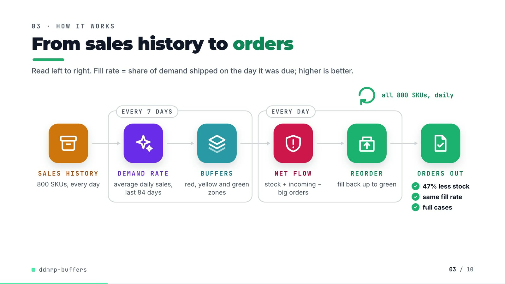

**On-screen text (verbatim)**

> 03 · HOW IT WORKS  
> From sales history to orders  
> Read left to right. Fill rate = share of demand shipped on the day it was due; higher is better.  
> SALES HISTORY 800 SKUs, every day → [EVERY 7 DAYS: DEMAND RATE average daily sales, last 84 days → BUFFERS red, yellow and green zones] → [EVERY DAY: NET FLOW stock + incoming − big orders → REORDER fill back up to green] → ORDERS OUT ✓ 47% less stock ✓ same fill rate ✓ full cases  
> all 800 SKUs, daily (loop over REORDER)  

**Figures on this slide**

| ID | Shown | Source · key | Calculation | Check |
|---|---|---|---|---|
| F-03 | 800 SKUs | `outputs/results.json` · dataset.skus | - | ✓ |
| F-11 | average daily sales, last 84 days / avg daily sales, 84 d / 84-d window | `src/ddmrp_buffers/config.py:24` · adu_window_days = 84 | - | ✓ |
| F-12 | EVERY 7 DAYS / weekly | `src/ddmrp_buffers/config.py:25; policies.py:154` · recalc_every_days = 7 | - | ✓ |
| F-13 | EVERY DAY / all 800 SKUs, daily / per-day call | `src/ddmrp_buffers/simulate.py:77-88` · for t in range(n_days): ... policy.order(...) | - | ✓ |
| F-14 | 47% less stock / same fill rate / full cases | `outputs/results.json; src/ddmrp_buffers/buffers.py:104-106` · matched_service DDMRP vs legacy year-2 DIO; round_up | (1 - 52.14 / 97.64) x 100 = 46.6% -> 47%; DIO read at the legacy fill rate (A-08) | ✓ |

**Assumptions:** A-05, A-08

**Illustrative, not data:**

- Icons and colours are a visual language, not data.
- 'same fill rate' and '47% less stock' hold at matched service (A-08), not at default settings.
- 'full cases' shortens the rounding rule: order quantities are rounded up to the case size and the minimum order quantity.

**To change this slide:** Edit CONFIG and the #ex-a-sub line in compositions/explainer.html; badge truth from outputs/results.json matched_service (F-14). (project folder `docs/demo/source`).

### Slide 04: The key idea (white chapter, slide B)  
*19.7-26.7 s · composition `compositions/explainer.html (slide B markup + its timeline block)`*

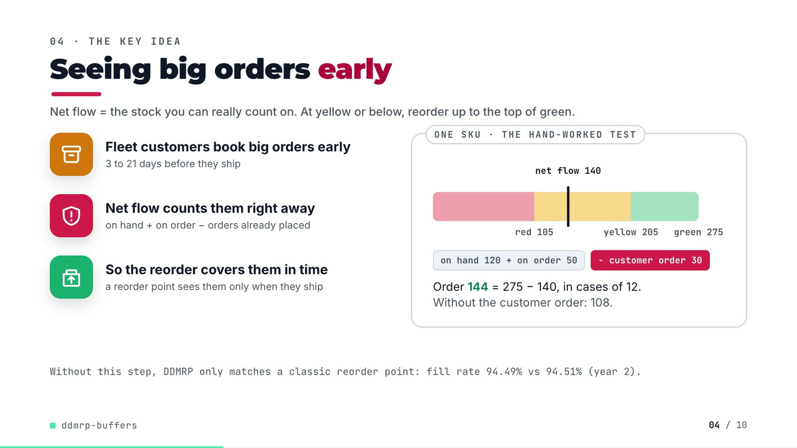

**On-screen text (verbatim)**

> 04 · THE KEY IDEA  
> Seeing big orders early  
> Net flow = the stock you can really count on. At yellow or below, reorder up to the top of green.  
> Fleet customers book big orders early — 3 to 21 days before they ship  
> Net flow counts them right away — on hand + on order − orders already placed  
> So the reorder covers them in time — a reorder point sees them only when they ship  
> ONE SKU · THE HAND-WORKED TEST: net flow 170 → 140; red 105 · yellow 205 · green 275; on hand 120 + on order 50; − customer order 30  
> Order 144 = 275 − 140, in cases of 12. Without the customer order: 108.  
> Without this step, DDMRP only matches a classic reorder point: fill rate 94.49% vs 94.51% (year 2).  

**Figures on this slide**

| ID | Shown | Source · key | Calculation | Check |
|---|---|---|---|---|
| F-09 | booked 3–21 d ahead / 3 to 21 days before they ship | `data/bulk_orders.csv` · due_date - placed_date (min, max) | - | ✓ |
| F-15 | on hand + on order − orders already placed | `src/ddmrp_buffers/buffers.py:99-101; policies.py:160-165` · net_flow() | - | ✓ |
| F-16 | red 105 / yellow 205 / green 275 / net flow 170 -> 140 / Order 144 | `tests/test_buffers.py:12-27 (test_zones_match_hand_worked_example)` · assertions in the test | 275 - 140 = 135 -> 144 (cases of 12) | ✓ |
| F-17 | Without the customer order: 108. | `tests/test_buffers.py:12-27 inputs; buffers.order_quantity / round_up` · net flow 170 (120 + 50), TOG 275, MOQ 50, case 12 | 275 - 170 = 105 -> ceil(105 / 12) x 12 = 108 | ✓ |
| F-18 | 94.49% vs 94.51% | `outputs/results.json` · policies['DDMRP, no order-spike visibility'] / ['reorder point (tuned)'].year_2.value_fill_rate | x 100, 2 decimals | ✓ |

**Assumptions:** A-02, A-05

**Illustrative, not data:**

- The buffer bar is drawn to scale for the hand-worked test SKU (tests/test_buffers.py), not a SKU from the range.

**To change this slide:** Slide B markup and the 'hand-worked buffer' block in the explainer timeline; the 108 is derived (F-17). (project folder `docs/demo/source`).

### Slide 05: Architecture  
*26.4-41.2 s · composition `compositions/s03-architecture.html (node markup + the wires list)`*

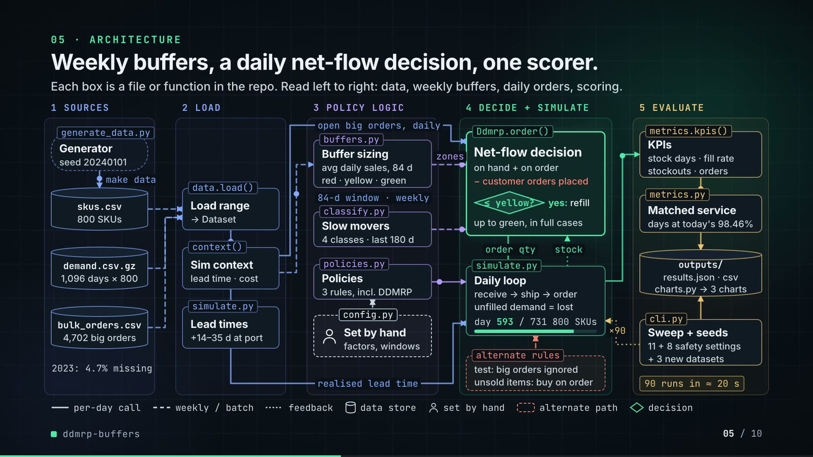

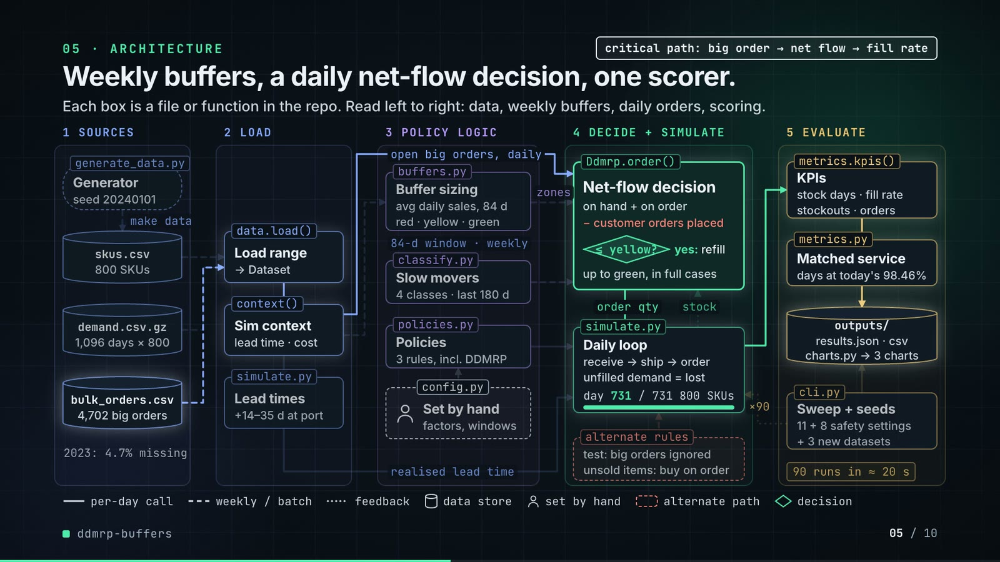

**On-screen text (verbatim)**

> 05 · ARCHITECTURE — Weekly buffers, a daily net-flow decision, one scorer.  
> Each box is a file or function in the repo. Read left to right: data, weekly buffers, daily orders, scoring.  
> 1 SOURCES: Generator (generate_data.py, seed 20240101) → skus.csv 800 SKUs · demand.csv.gz 1,096 days × 800 · bulk_orders.csv 4,702 big orders · 2023: 4.7% missing  
> 2 LOAD: Load range (data.load(), → Dataset) · Sim context (context(), lead time · cost) · Lead times (simulate.py, +14–35 d at port)  
> 3 POLICY LOGIC: Buffer sizing (buffers.py, avg daily sales, 84 d; red · yellow · green) · Slow movers (classify.py, 4 classes · last 180 d) · Policies (policies.py, 3 rules, incl. DDMRP) · Set by hand (config.py, factors, windows)  
> 4 DECIDE + SIMULATE: Net-flow decision (Ddmrp.order(): on hand + on order − customer orders placed; ≤ yellow? yes: refill; up to green, in full cases) · Daily loop (simulate.py: receive → ship → order; unfilled demand = lost; day 0→731 / 731, 800 SKUs) · alternate rules (test: big orders ignored; unsold items: buy on order)  
> 5 EVALUATE: KPIs (metrics.kpis(): stock days · fill rate, stockouts · orders) · Matched service (metrics.py: days at today's 98.46%) · outputs/ (results.json · csv, charts.py → 3 charts) · Sweep + seeds (cli.py: 11 + 8 safety settings, + 3 new datasets) · 90 runs in ≈ 20 s  
> Edge labels: make data · open big orders, daily · 84-d window · weekly · realised lead time · zones · order qty · stock · ×90  
> Legend: per-day call · weekly / batch · feedback · data store · set by hand · alternate path · decision  
> Second phase (38.4-41.2 s): critical path: big order → net flow → fill rate (bulk_orders.csv → data.load() → context() → Ddmrp.order() → daily loop → KPIs → matched service → outputs/); other boxes stay at 75% opacity  

**Figures on this slide**

| ID | Shown | Source · key | Calculation | Check |
|---|---|---|---|---|
| F-03 | 800 SKUs | `outputs/results.json` · dataset.skus | - | ✓ |
| F-08 | 4,702 big orders | `outputs/results.json; data/bulk_orders.csv` · dataset.bulk_orders | - | ✓ |
| F-11 | average daily sales, last 84 days / avg daily sales, 84 d / 84-d window | `src/ddmrp_buffers/config.py:24` · adu_window_days = 84 | - | ✓ |
| F-12 | EVERY 7 DAYS / weekly | `src/ddmrp_buffers/config.py:25; policies.py:154` · recalc_every_days = 7 | - | ✓ |
| F-13 | EVERY DAY / all 800 SKUs, daily / per-day call | `src/ddmrp_buffers/simulate.py:77-88` · for t in range(n_days): ... policy.order(...) | - | ✓ |
| F-19 | seed 20240101 | `src/ddmrp_buffers/config.py:8` · SEED | - | ✓ |
| F-20 | 1,096 days × 800 / 2023: 4.7% missing | `outputs/results.json` · dataset.days_total, dataset.history_missing_share | - | ✓ |
| F-21 | +14–35 d at port | `src/ddmrp_buffers/simulate.py:49-50` · 10% of import orders held rng.integers(14, 36) days | - | ✓ |
| F-22 | avg daily sales, 84 d / red · yellow · green / ≤ yellow? yes: refill up to green, in full cases | `src/ddmrp_buffers/buffers.py:35-119` · average_daily_usage, lead_time_factor, variability_factor, zones, net_flow, order_quantity | - | ✓ |
| F-23 | 4 classes · last 180 d | `src/ddmrp_buffers/classify.py:13-14; config.py:66` · RUNNER, REPEATER, STRANGER, DORMANT; window_days = 180 | - | ✓ |
| F-24 | day 731 / 731 · 731 simulated days | `outputs/results.json` · dataset.days_simulated | - | ✓ |
| F-25 | 11 + 8 safety settings / Reorder point run at 11 safety settings, DDMRP at 8 | `src/ddmrp_buffers/cli.py:14-15` · len(ROP_Z_SWEEP), len(DDMRP_RED_SWEEP) | - | ✓ |
| F-26 | + 3 new datasets / 4 datasets | `outputs/results.json robustness; cli.py:252` · len(robustness) = 4 (main + 3) | - | ✓ |
| F-27 | ×90 / 90 runs | `src/ddmrp_buffers/cli.py:18-25, 76-93, 120-131, 175-177` · 5 arms + 19 sweep runs on the main range; 3 policies + 19 sweep runs on each of 3 extra ranges | 5 + 19 + 3 x (3 + 19) = 90 | ✓ |
| F-28 | ≈ 20 s / ~20 s | `README 'Running it'` · '(~20 s)' | - | ✓ |
| F-29 | 98.46% | `outputs/results.json` · matched_service.target_value_fill_rate_year_2 | x 100 | ✓ |
| F-30 | generate_data.py, data.load(), context(), simulate.py, buffers.py, classify.py, policies.py, config.py, Ddmrp.order(), metrics.kpis(), metrics.py, cli.py, charts.py, outputs/ | `src/ddmrp_buffers/, scripts/` · files + functions | - | ✓ |

- *F-28 note:* Stated in the README; results.json does not record a run time, and it depends on the machine.

**Assumptions:** A-01, A-02, A-04, A-05, A-07, A-08

**Illustrative, not data:**

- Packets and the day counter show execution order, not real-time speed.
- 'alternate rules' groups two real code paths: the no-spike ablation arm (use_spikes=False, 'big orders ignored') and the slow-mover rule (dormant SKUs bought only against an order in hand).
- '3 rules' = the three policy classes in policies.py (LegacyMinMax, ReorderPoint, Ddmrp); the five compared policies are these plus two DDMRP switches.
- The critical-path highlight is emphasis only.

**To change this slide:** Boxes are absolutely positioned divs in compositions/s03-architecture.html; wires are the `wires` point lists in its script (keep them orthogonal and matching the box edges); `crit: true` and `critNodes` set the highlighted path. (project folder `docs/demo/source`).

### Slide 06: The system running  
*40.8-55.4 s · composition `compositions/s04-routes.html`*

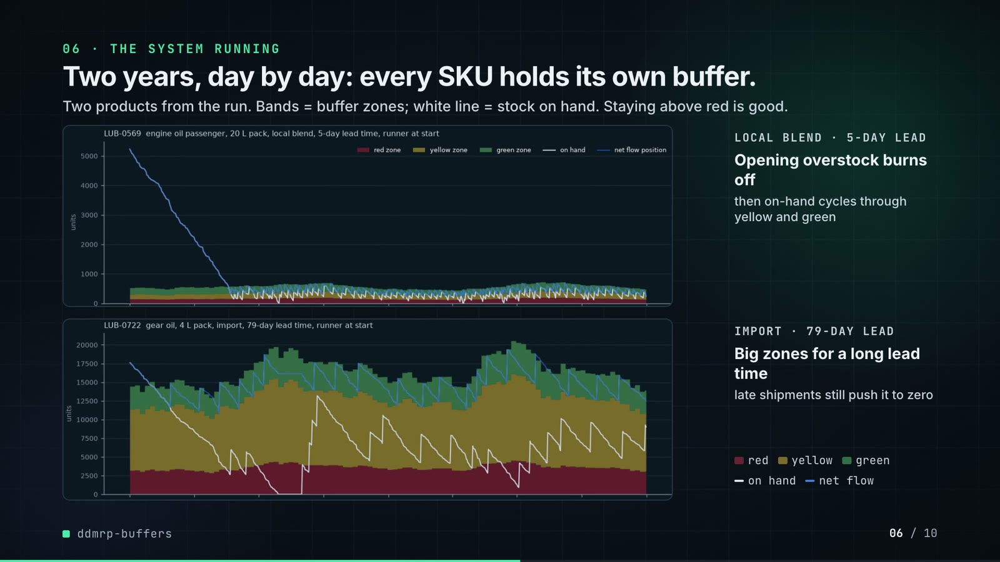

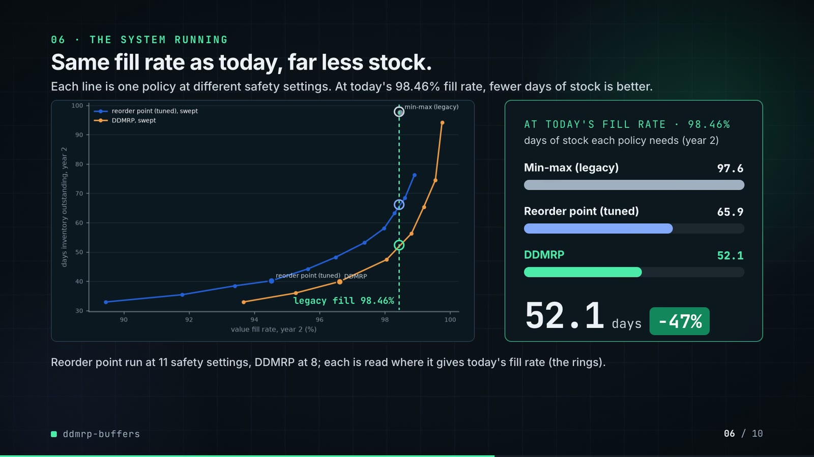

**On-screen text (verbatim)**

> 06 · THE SYSTEM RUNNING — Two years, day by day: every SKU holds its own buffer.  
> Two products from the run. Bands = buffer zones; white line = stock on hand. Staying above red is good.  
> LOCAL BLEND · 5-DAY LEAD — Opening overstock burns off, then on-hand cycles through yellow and green  
> IMPORT · 79-DAY LEAD — Big zones for a long lead time, late shipments still push it to zero  
> Second phase: Same fill rate as today, far less stock.  
> Each line is one policy at different safety settings. At today's 98.46% fill rate, fewer days of stock is better.  
> AT TODAY'S FILL RATE · 98.46% — days of stock each policy needs (year 2): Min-max (legacy) 97.6 · Reorder point (tuned) 65.9 · DDMRP 52.1 — 52.1 days −47%  
> Reorder point run at 11 safety settings, DDMRP at 8; each is read where it gives today's fill rate (the rings).  

**Figures on this slide**

| ID | Shown | Source · key | Calculation | Check |
|---|---|---|---|---|
| F-25 | 11 + 8 safety settings / Reorder point run at 11 safety settings, DDMRP at 8 | `src/ddmrp_buffers/cli.py:14-15` · len(ROP_Z_SWEEP), len(DDMRP_RED_SWEEP) | - | ✓ |
| F-29 | 98.46% | `outputs/results.json` · matched_service.target_value_fill_rate_year_2 | x 100 | ✓ |
| F-31 | LOCAL BLEND · 5-DAY LEAD / IMPORT · 79-DAY LEAD | `outputs/buffer_chart.png (panel titles); data/skus.csv` · sku, source, lead_time_days | - | ✓ |
| F-32 | legacy fill 98.46% + three rings | `outputs/frontier.png (axes); compositions/s04-routes.html (X/Y mapping)` · tick positions in the dark image | x = 332 + (fill - 90) x 150.1, y = 968 - (DIO - 30) x 13.514 (image pixels) | manual |
| F-33 | 97.6 / 65.9 / 52.1 | `outputs/results.json` · policies['min-max (legacy)'].year_2.dio_days; matched_service.dio_at_target | - | ✓ |
| F-34 | −47% | `outputs/results.json` · F-33 | (52.14 / 97.64 - 1) x 100 = -46.6% | ✓ |

**Assumptions:** A-04, A-07, A-08, A-09

**Illustrative, not data:**

- Panels are outputs/buffer_chart.png and outputs/frontier.png converted to dark by tools/darkmap.py; nothing is redrawn.
- The dashed line and rings on the frontier are annotations (F-32).
- Side captions describe what the two plotted SKUs show (README 'How it works').

**To change this slide:** Re-run tools/darkmap.py after make run; bar widths in #routes-f1..3 are 520 x DIO / 97.6; the counter tweens 97.6 → 52.1. (project folder `docs/demo/source`).

### Slide 07: End-user value (white)  
*55.1-68.1 s · composition `compositions/value.html (SHEET injected by tools/inject_sheet.py)`*

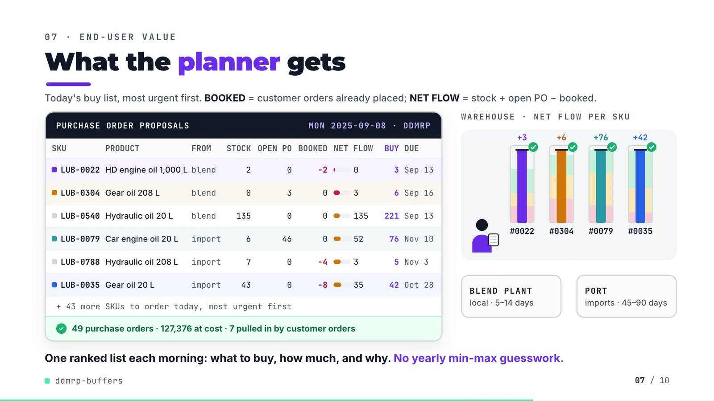

**On-screen text (verbatim)**

> 07 · END-USER VALUE — What the planner gets  
> Today's buy list, most urgent first. BOOKED = customer orders already placed; NET FLOW = stock + open PO − booked.  
> PURCHASE ORDER PROPOSALS · MON 2025-09-08 · DDMRP  
> SKU · PRODUCT · FROM · STOCK · OPEN PO · BOOKED · NET FLOW · BUY · DUE  
> LUB-0022 HD engine oil 1,000 L blend 2 0 −2 0 3 Sep 13  
> LUB-0304 Gear oil 208 L blend 0 3 0 3 6 Sep 16  
> LUB-0540 Hydraulic oil 20 L blend 135 0 0 135 221 Sep 13  
> LUB-0079 Car engine oil 20 L import 6 46 0 52 76 Nov 10  
> LUB-0788 Hydraulic oil 208 L import 7 0 −4 3 5 Nov 3  
> LUB-0035 Gear oil 20 L import 43 0 −8 35 42 Oct 28  
> + 43 more SKUs to order today, most urgent first  
> 49 purchase orders · 127,376 at cost · 7 pulled in by customer orders  
> Scene: WAREHOUSE · NET FLOW PER SKU (#0022 +3, #0304 +6, #0079 +76, #0035 +42) · BLEND PLANT local · 5–14 days · PORT imports · 45–90 days  
> One ranked list each morning: what to buy, how much, and why. No yearly min-max guesswork.  

**Figures on this slide**

| ID | Shown | Source · key | Calculation | Check |
|---|---|---|---|---|
| F-35 | MON 2025-09-08 · DDMRP | `demo assets/po_sheet.json (re-run of the repo's default DDMRP simulation)` · day, weekday | - | ✓ |
| F-36 | 49 purchase orders | `demo assets/po_sheet.json` · orders = number of SKUs with order qty > 0 | - | ✓ |
| F-37 | 127,376 at cost | `demo assets/po_sheet.json` · order_value = sum(order qty x unit cost) | - | ✓ |
| F-38 | 7 pulled in by customer orders | `demo assets/po_sheet.json` · with_customer_orders = 7; triggered_by_customer_orders = 7 (net flow without them would sit above top of yellow) | - | ✓ |
| F-39 | + 43 more SKUs to order today | `F-36` · 49 - 6 rows | 49 - 6 = 43 | ✓ |
| F-40 | LUB-0022, LUB-0304, LUB-0540, LUB-0079, LUB-0788, LUB-0035 | `demo assets/po_sheet.json, injected into compositions/value.html` · rows by SKU | due = order day + nominal lead time; rows ordered most urgent first (net flow / top of green); LUB-0540 kept as a high-volume line | ✓ |
| F-41 | local · 5–14 days / imports · 45–90 days | `data/skus.csv` · lead_time_days by source (min, max) | - | ✓ |
| F-42 | +3 / +6 / +76 / +42 with green checks | `demo assets/po_sheet.json` · net_flow + order_qty >= tog | - | ✓ |

**Assumptions:** A-04, A-05, A-11

**Illustrative, not data:**

- The planner, trucks and supplier boxes are a flat 2D scene, not data.
- Gauge zones and levels are to scale per SKU from po_sheet.json (red / yellow / green, net flow, net flow + order); each gauge has its own scale.
- DUE = order day + nominal lead time; the simulation's realised lead time can differ (A-04).
- 'Booked' = customer orders already placed that count against the buffer (qualified spikes).

**To change this slide:** Change the day in tools/export_po_sheet.py, re-run it and tools/inject_sheet.py (choose --rows / --animate from the new JSON), then render. (project folder `docs/demo/source`).

### Slide 08: Results  
*67.8-76.6 s · composition `compositions/s05-results.html`*

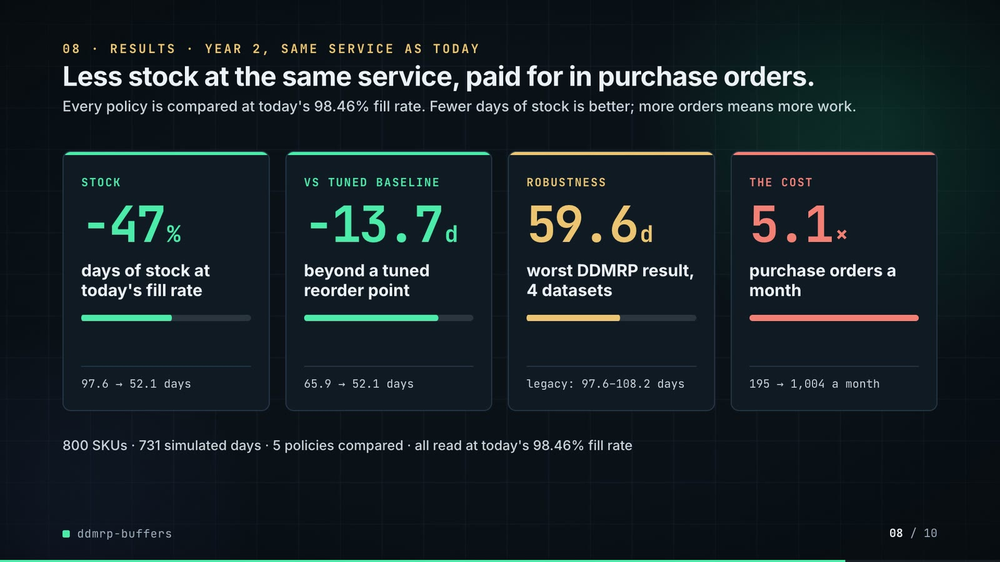

**On-screen text (verbatim)**

> 08 · RESULTS · YEAR 2, SAME SERVICE AS TODAY — Less stock at the same service, paid for in purchase orders.  
> Every policy is compared at today's 98.46% fill rate. Fewer days of stock is better; more orders means more work.  
> STOCK −47% days of stock at today's fill rate · 97.6 → 52.1 days  
> VS TUNED BASELINE −13.7 d beyond a tuned reorder point · 65.9 → 52.1 days  
> ROBUSTNESS 59.6 d worst DDMRP result, 4 datasets · legacy: 97.6–108.2 days  
> THE COST 5.1× purchase orders a month · 195 → 1,004 a month  
> 800 SKUs · 731 simulated days · 5 policies compared · all read at today's 98.46% fill rate  

**Figures on this slide**

| ID | Shown | Source · key | Calculation | Check |
|---|---|---|---|---|
| F-03 | 800 SKUs | `outputs/results.json` · dataset.skus | - | ✓ |
| F-24 | day 731 / 731 · 731 simulated days | `outputs/results.json` · dataset.days_simulated | - | ✓ |
| F-26 | + 3 new datasets / 4 datasets | `outputs/results.json robustness; cli.py:252` · len(robustness) = 4 (main + 3) | - | ✓ |
| F-29 | 98.46% | `outputs/results.json` · matched_service.target_value_fill_rate_year_2 | x 100 | ✓ |
| F-34 | −47% | `outputs/results.json` · F-33 | (52.14 / 97.64 - 1) x 100 = -46.6% | ✓ |
| F-43 | −13.7 d (65.9 → 52.1 days) | `outputs/results.json` · matched_service.dio_at_target | 65.888 - 52.140 = 13.75 -> 13.7 | ✓ |
| F-44 | 59.6 d | `outputs/results.json` · max(robustness[].ddmrp_dio_at_legacy_fill) | max over 4 ranges | ✓ |
| F-45 | legacy: 97.6–108.2 days | `outputs/results.json` · robustness[].legacy_dio (min, max) | - | ✓ |
| F-46 | 5.1× | `outputs/results.json` · policies[*].year_2.purchase_orders_per_month: 1,004.1 / 195.1 | 1,004.1 / 195.1 = 5.15 | ✓ |
| F-47 | 195 → 1,004 a month | `outputs/results.json` · policies[*].year_2.purchase_orders_per_month | - | ✓ |
| F-48 | 5 policies | `outputs/results.json` · len(policies) | - | ✓ |

- *F-43 note:* The README rounds the inputs first (65.9 - 52.1 = 13.8 days); the slide shows the difference of the unrounded values.

**Assumptions:** A-07, A-08, A-09, A-12

**Illustrative, not data:**

- Mini bars are proportional to the shown ratios.

**To change this slide:** Edit the `stats` array and card text in compositions/s05-results.html. (project folder `docs/demo/source`).

### Slide 09: Lesson and fix  
*76.2-85.2 s · composition `compositions/s06-twist.html`*

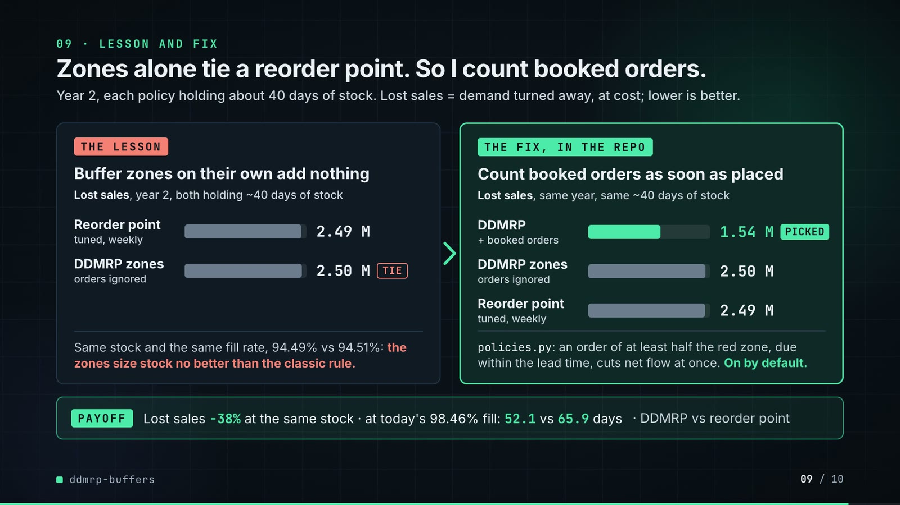

**On-screen text (verbatim)**

> 09 · LESSON AND FIX — Zones alone tie a reorder point. So I count booked orders.  
> Year 2, each policy holding about 40 days of stock. Lost sales = demand turned away, at cost; lower is better.  
> THE LESSON — Buffer zones on their own add nothing · Lost sales, year 2, both holding ~40 days of stock: Reorder point (tuned, weekly) 2.49 M · DDMRP zones (orders ignored) 2.50 M [TIE]  
> Same stock and the same fill rate, 94.49% vs 94.51%: the zones size stock no better than the classic rule.  
> THE FIX, IN THE REPO — Count booked orders as soon as placed · Lost sales, same year, same ~40 days of stock: DDMRP (+ booked orders) 1.54 M [PICKED] · DDMRP zones (orders ignored) 2.50 M · Reorder point (tuned, weekly) 2.49 M  
> policies.py: an order of at least half the red zone, due within the lead time, cuts net flow at once. On by default.  
> PAYOFF — Lost sales −38% at the same stock · at today's 98.46% fill: 52.1 vs 65.9 days · DDMRP vs reorder point  

**Figures on this slide**

| ID | Shown | Source · key | Calculation | Check |
|---|---|---|---|---|
| F-18 | 94.49% vs 94.51% | `outputs/results.json` · policies['DDMRP, no order-spike visibility'] / ['reorder point (tuned)'].year_2.value_fill_rate | x 100, 2 decimals | ✓ |
| F-29 | 98.46% | `outputs/results.json` · matched_service.target_value_fill_rate_year_2 | x 100 | ✓ |
| F-49 | 2.49 M / 2.50 M / 1.54 M | `outputs/results.json` · policies['reorder point (tuned)' \| 'DDMRP, no order-spike visibility' \| 'DDMRP'].year_2.lost_sales_value | / 1e6, 2 decimals | ✓ |
| F-50 | about 40 days of stock / ~40 days of stock | `outputs/results.json` · policies[*].year_2.dio_days | each within 40 ± 0.5 days | ✓ |
| F-51 | −38% | `outputs/results.json` · F-49 | 1.5405 / 2.5026 - 1 = -38.4%; 1.5405 / 2.4906 - 1 = -38.1% | ✓ |
| F-52 | policies.py: an order of at least half the red zone, due within the lead time, cuts net flow at once. On by default. | `src/ddmrp_buffers/policies.py:39-47, 119, 160-165; config.py:39; tests/test_simulation.py:79-97` · Context.open_spikes, Ddmrp.use_spikes, spike_threshold_share = 0.5 | - | ✓ |
| F-53 | 52.1 vs 65.9 days | `outputs/results.json` · matched_service.dio_at_target | - | ✓ |

- *F-49 note:* Bars share one scale on both panels: 100 px per million (2.6 M = 260 px).

**Assumptions:** A-02, A-03, A-05, A-07, A-08, A-09

**Illustrative, not data:**

- Bar width = 100 px per million of lost sales, one scale on both panels; neutral grey for every option, mint only for the picked fix.
- 'TIE' marks the trap: zone sizing alone gives the reorder point's result.
- 'PICKED' = the repo's default DDMRP policy (use_spikes=True); it is the policy behind every headline number.

**To change this slide:** Rows #twist-l1..l2 / #twist-r1..r3, the notes and #twist-payoff in compositions/s06-twist.html; bar widths are lost sales in millions x 100 px. (project folder `docs/demo/source`).

### Slide 10: End card  
*84.8-89.2 s · composition `compositions/s07-end.html`*

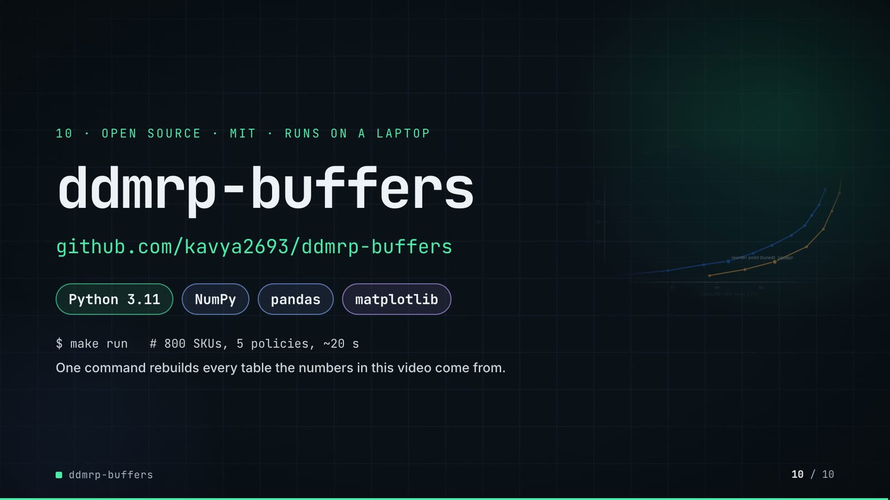

**On-screen text (verbatim)**

> 10 · OPEN SOURCE · MIT · RUNS ON A LAPTOP  
> ddmrp-buffers  
> github.com/kavya2693/ddmrp-buffers  
> Python 3.11 · NumPy · pandas · matplotlib  
> $ make run   # 800 SKUs, 5 policies, ~20 s  
> One command rebuilds every table the numbers in this video come from.  

**Figures on this slide**

| ID | Shown | Source · key | Calculation | Check |
|---|---|---|---|---|
| F-03 | 800 SKUs | `outputs/results.json` · dataset.skus | - | ✓ |
| F-28 | ≈ 20 s / ~20 s | `README 'Running it'` · '(~20 s)' | - | ✓ |
| F-48 | 5 policies | `outputs/results.json` · len(policies) | - | ✓ |
| F-54 | MIT | `LICENSE line 1` · - | - | ✓ |
| F-55 | Python 3.11 · NumPy · pandas · matplotlib | `pyproject.toml` · requires-python, dependencies | - | ✓ |
| F-56 | $ make run | `Makefile` · run target | - | ✓ |

- *F-28 note:* Stated in the README; results.json does not record a run time, and it depends on the machine.

**Assumptions:** A-13

**Illustrative, not data:**

- Faded chart in the background is outputs/frontier.png.

**To change this slide:** Text in compositions/s07-end.html. (project folder `docs/demo/source`).

## 5. Change-impact matrix

| Input / assumption | Affected figures | Affected slides | Files to edit | Commands to re-run |
|---|---|---|---|---|
| A-01: All data is synthetic, produced by a seeded generator sized to the production problem (800 SKUs, three years of daily demand, 4,702 bulk orders) | all figures | 01, 02, 03, 04, 05, 06, 07, 08, 09, 10 | `src/ddmrp_buffers/data.py; src/ddmrp_buffers/config.py` | `make data; make run` |
| A-02: Bulk fleet orders are announced 3 to 21 days before they ship: 60% of SKUs packed in 18 L or more get 2-8 such orders a year (15% of the rest get 2) | F-08, F-09, F-16, F-17, F-18, F-36, F-37, F-38, F-49, F-51 | 02, 04, 05, 07, 09 | `src/ddmrp_buffers/data.py:157-169` | `make data; make run; export_po_sheet.py + inject_sheet.py` |
| A-03: Unfilled demand is lost, not backordered (a workshop buys the drum elsewhere) | F-18, F-29, F-33, F-34, F-43, F-44, F-49, F-51, F-53 | 04, 05, 06, 08, 09 | `src/ddmrp_buffers/simulate.py:81-83` | `make run` |
| A-04: Lead times: local blends 5-14 days, imports 45-90 days | F-07, F-21, F-33, F-34, F-41, F-44, F-49, F-50, F-51, F-53 | 02, 05, 06, 07, 08, 09 | `src/ddmrp_buffers/data.py:109-114; src/ddmrp_buffers/simulate.py:46-50` | `make data; make run` |
| A-05: DDMRP settings: 84-day ADU window, buffers recalculated every 7 days, lead-time factor 0 | F-11, F-12, F-22, F-33, F-34, F-36, F-37, F-38, F-40, F-42, F-43, F-44, F-49, F-50, F-51, F-52, F-53 | 03, 05, 06, 07, 08, 09 | `src/ddmrp_buffers/config.py:24-41` | `make run; export_po_sheet.py + inject_sheet.py` |
| A-06: Legacy min-max: min = usage over lead time + 30 days, max = min + 90 days (blend) or 180 days (import), reset once a year from last year's average daily usage | F-29, F-33, F-34, F-45, F-47, F-53 | 05, 06, 08, 09 | `src/ddmrp_buffers/config.py:48-50` | `make run` |
| A-07: Tuned reorder point: z = 1 | F-25, F-27, F-33, F-34, F-43, F-44, F-49, F-50, F-53 | 05, 06, 08, 09 | `src/ddmrp_buffers/config.py:59; src/ddmrp_buffers/cli.py:14-15` | `make run` |
| A-08: Stock at matched service = DIO linearly interpolated along each policy's swept (fill rate, DIO) curve at the legacy policy's year-2 fill rate (98 | F-14, F-29, F-33, F-34, F-43, F-44, F-53 | 03, 05, 06, 08, 09 | `src/ddmrp_buffers/metrics.py:42-49` | `make run` |
| A-09: Headline window is year 2 of the simulation (2025), after the opening overstock has worked through; 2023 is history only, 2024-2025 are simulated (731 days) | F-24, F-29, F-33, F-34, F-43, F-44, F-45, F-46, F-47, F-49, F-50, F-51, F-53 | 05, 06, 08, 09 | `src/ddmrp_buffers/config.py:10-12` | `make data; make run` |
| A-10: Opening stock reflects generous cover (lognormal around 110 days, x1 | F-04, F-05 | 02 | `src/ddmrp_buffers/data.py:182-184` | `make data; make run` |
| A-11: Lead-time draws use simulation seed 7 for the main range; the three extra ranges use their own seed for both the range and the draws | F-35, F-36, F-37, F-38, F-39, F-40, F-42, F-44, F-45 | 07, 08 | `docs/demo/source/tools/export_po_sheet.py (day argument)` | `export_po_sheet.py + inject_sheet.py; hyperframes render` |
| A-12: Purchase orders are counted, not costed: there is no ordering or freight cost in the comparison | F-46, F-47 | 08 | `src/ddmrp_buffers/metrics.py` | `make run` |
| A-13: Video rounding: days to 1 decimal, fill rates to 2 decimals, headline percentages to whole numbers, money to 0 | F-04, F-05, F-06, F-10, F-14, F-20, F-34, F-43, F-46, F-49, F-50, F-51 | 02, 03, 05, 06, 08, 09 | `the composition file named on each slide` | `hyperframes render` |
| A-14: Slide 01 (industries, everyday problems) is general distribution knowledge used as context | F-01, F-02 | 01 | `compositions/s01-context.html` | `hyperframes render` |

## 6. Known differences and caveats

- The data is generated (A-01). DDMRP's edge over the reorder point comes from bulk orders being visible 3-21 days ahead; that share and notice period are generator choices (A-02), so with a real order book the gap could be larger or close to zero (README 'Known limitations').
- '47% less stock' and 'same fill rate' hold at matched service (DIO interpolated at the legacy fill rate, A-08). At default settings DDMRP's fill rate is lower than legacy (96.61% vs 98.46%) and lost sales more than double.
- −13.7 days (slide 08) is the difference of the unrounded matched-service DIOs (13.75); the README's 13.8 subtracts the rounded values (65.9 − 52.1).
- 'Worst DDMRP case' (59.6 d) and the legacy range (97.6-108.2 d) are over the main range and three freshly generated ones; on one of them (seed 20240103) the tuned reorder point never reaches the legacy fill rate in its sweep.
- Slide 07 shows one day (2025-09-08) re-run by tools/export_po_sheet.py with the repo's own DDMRP policy, data and seed; the day was chosen by the video author. DUE dates use the nominal lead time.
- Purchase orders are counted, not costed (A-12): the 5.1x workload is real in the simulation, its cost is not modelled.
- The architecture slide groups two code paths as 'alternate rules': the no-spike ablation arm and the slow-mover rule (strangers keep the red zone only, dormant SKUs are bought only against an order in hand).
- Slide 09 shows the lesson on lost sales at default settings (all three policies hold 39.8-40.1 days). Two findings it no longer shows are still in the README ('The result', findings 1 and 2): about 70% of the stock cut at matched service comes from recalculating weekly (a tuned reorder point already gets 97.6 to 65.9 days), and bulk orders are 13.6% of simulated demand value, which is why counting them pays off here.
- The fix on slide 09 (counting booked orders) is DDMRP's standard net flow equation, implemented in policies.py and switched off only in the ablation arm; its size depends on how many orders are booked ahead in the generated data (A-02, README 'Known limitations').
- Slide 01 statements are general industry knowledge (A-14).
- make run time (~20 s) is the README's statement for the author's laptop; it is not recorded in results.json.

## Appendix: environment

- Commit: `ef2e4977bbb5278cf24e612031c686ff3d296161`
- Python: 3.11.7
- numpy 2.4.6
- pandas 3.0.6
- matplotlib 3.11.2
- Profile / seeds: data_seed=20240101, lead_time_draw_seed=7, extra_range_seeds=20240102, 20240103, 20240104
- Run time: README 'Running it': make run takes about 20 s on the author's laptop (results.json does not record a run time)
